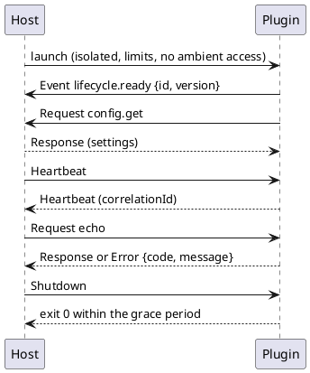

# Sandboxed Plugin Host — Protocol and manifest schema

[← Threat model](threat-model.md) · [↑ Overview](README.md)

**Status:** Draft for owner review · **Date:** 2026-10-29

Phase 1 design (REQ-009, REQ-002, REQ-006). It fixes what is on the wire and in the manifest so a plugin in any language can be written from this page. It is based on the proof-of-concept wire profile (`PROFILE.md` in `examples/plugin-sandbox-poc`), which carried five languages and the real host's 36 conformance checks unchanged, and it adds versioning, grants and a manifest schema. Decisions here are reversible until a launcher ships.

## Contents

- [Framing and encoding](#framing-and-encoding)
- [Envelope](#envelope)
- [Message flow](#message-flow)
- [Plugin rules](#plugin-rules)
- [Versioning](#versioning)
- [Manifest](#manifest)
- [Open points](#open-points)

### List of Figures

1. [Figure 3 — Start, request and shutdown](#figure-3)

### List of Tables

1. [Table 7 — Envelope fields](#table-7)
2. [Table 8 — Host violations and reactions](#table-8)
3. [Table 9 — Manifest fields](#table-9)

## Framing and encoding

One frame per message on the plugin's stdin (host to plugin) and stdout (plugin to host): a 4-byte little-endian unsigned length, then that many bytes of a UTF-8 JSON object. The maximum body is 1 048 576 bytes. Stdout carries frames only; logs go to stderr; end of input means the host is gone and the plugin exits.

JSON stays the encoding. The proof of concept measured a 1 MB round trip at 4 to 7 ms and 1 KB at 0.07 ms, with the plugin's own JSON handling dominating, so a binary codec buys nothing on a control channel. Bulk binary data does not go in frames: the broker hands the plugin a granted file or pipe instead (REQ-004). Language neutrality (REQ-009) comes from this page plus a published JSON Schema for the envelope and the manifest; there is no IDL compiler to ship.

## Envelope

<a id="table-7"></a>**Table 7 — Envelope fields**

| Field | Type | Rule |
|-------|------|------|
| `v` | integer | Protocol major version of the sender. New in this design; the proof of concept carried the version only in the manifest |
| `type` | string | Exact name: `Request`, `Response`, `Event`, `Heartbeat`, `Shutdown`, `Error`. Numbers and combined values are rejected |
| `requestId` | GUID string | New for every message |
| `correlationId` | GUID string, optional | On `Response`, `Error` and heartbeat replies: the `requestId` answered |
| `topic` | string, optional | What the message is about; dotted lower case |
| `target` | string, optional | A logical name or capability, never a process id or pipe name |
| `source` | string | Stamped by the host from the channel; any plugin value is ignored |
| `ttlMs` | integer, optional | Request deadline |
| `hops` | integer, optional | Relay counter; the host drops a message over the limit |
| `payload` | any JSON, optional | Topic specific; hostile in both directions |

Receivers parse into a concrete schema and ignore unknown fields. There is no type-name or polymorphic deserialization. UTF-8 is validated before parsing, because a lazy parser accepted invalid bytes inside a skipped field in the proof of concept.

Topics a plugin may send are those its manifest lists under `publish`, plus `lifecycle.ready` and `config.get`. All other `lifecycle.*` topics are host only. A `ResourceRequest` and `ResourceGrant` pair for brokered access is added with the broker in phase 2 and is not in version 1 of the wire.

<a id="table-8"></a>**Table 8 — Host violations and reactions**

| Violation | Reaction |
|-----------|----------|
| Frame length over the cap, or an invalid length | Disconnect and kill |
| Body not valid UTF-8 or JSON, or unknown `type` | Disconnect and kill |
| Rate over `msgPerSec` | Drop the excess and count it; kill when sustained |
| Topic outside the manifest | Refuse, log, count; kill after repeated attempts |
| Heartbeat unanswered, or three consecutive request timeouts | Declare hung and kill; restart policy applies |
| `source` set by the plugin | Ignore the value |
| Unexpected exit, including exit 0 without a `Shutdown` | Treat as a crash; at five crashes in the window stop launching and report `Failed` |

## Message flow

<a id="figure-3"></a>



*Figure 3 — Start, request and shutdown*

## Plugin rules

1. Send `lifecycle.ready` with `{id, version}` after startup, within the ready timeout (10 s by default).
2. Answer a heartbeat from the same loop that handles requests. A side thread that only heartbeats hides a stuck plugin, so request time to live also counts.
3. Answer every `Request` with a `Response` or an `Error` whose payload is `{code, message}`; unknown topics get code `unknown-topic`.
4. On `Shutdown`, finish and exit 0 within the grace period; be killable at any instant, because the host owns committed state.
5. Ask for configuration with `config.get`; never read it from disk. Keep answering heartbeats and `Shutdown` while waiting.
6. Use stdout for frames only and read nothing but stdin.

## Versioning

The protocol version is `major.minor`. The manifest names the version the plugin was built for and the envelope carries the major. The host refuses a plugin whose major it does not support, with a reason in the log, before launch. Within a major, minor versions only add optional fields, new topics and new error codes; a receiver ignores what it does not know. A removed or changed meaning needs a new major, and the host may support two majors at once while plugins migrate. Conformance (the proof of concept's 36 checks, ported) is the contract test: a platform is listed in a manifest only after the plugin passes it there.

## Manifest

The manifest is JSON inside the signed package. The signature covers the manifest bytes and the manifest carries a SHA-256 for every file (REQ-006). `entry.dev` from the proof of concept is not part of the schema; a development switch in the host may accept it from an explicitly named folder only.

<a id="table-9"></a>**Table 9 — Manifest fields**

| Field | Required | Meaning |
|-------|----------|---------|
| `id` | yes | Plain name: letters, digits, `-`, `_`, `.`; no path characters |
| `version` | yes | Semantic version of the plugin |
| `protocol` | yes | `major.minor` the plugin speaks |
| `platforms` | yes | Subset of `win-x64`, `win-arm64`, `linux-x64`, `linux-arm64`, `linux-musl-x64`, `osx-universal` |
| `entry` | yes | Map from platform to the relative executable path |
| `lifetime` | no | `Bound` (default; dies with the host) or `Detached` (not in the first version) |
| `permissions` | yes | What the plugin requests; the user approves a subset (REQ-002). Shape below |
| `limits` | no | `memoryMb`, `cpuPercent`, `maxProcesses`, `wallTimeSec`, `msgPerSec`, `maxFrameBytes`; the host applies its own ceilings |
| `heartbeatTimeout` | no | Duration; default from the host |
| `files` | yes | Map from relative path to `sha256:` digest, covering every file |
| `signature` | yes | Detached signature over the manifest, with the key id of a key in the host's trust list |

```json
{
  "id": "telemetry",
  "version": "1.2.0",
  "protocol": "1.0",
  "platforms": ["win-x64", "linux-x64"],
  "entry": { "win-x64": "win-x64/telemetry.exe", "linux-x64": "linux-x64/telemetry" },
  "permissions": {
    "files": [{ "path": "data", "access": "rw" }],
    "network": [{ "host": "api.example.org", "port": 443 }],
    "publish": ["device.readings"],
    "subscribe": ["config.updated"],
    "sendTo": ["analytics"]
  },
  "limits": { "memoryMb": 256, "cpuPercent": 25, "maxProcesses": 1, "wallTimeSec": 3600 },
  "files": { "win-x64/telemetry.exe": "sha256:…", "linux-x64/telemetry": "sha256:…" },
  "signature": { "keyId": "…", "value": "…" }
}
```

Permissions are requests, not grants. Network and file entries name exact hosts and folders; there are no wildcards in the first version. The host stores the approved subset in the grant store with who approved it and when, and the broker checks the grant on every call (REQ-003, REQ-004). A package that requests nothing runs with no files, no network and no peers.

## Open points

- The Windows and Linux launchers need the owner's placement answer (Q6) before any code. This page does not depend on it.
- Key rotation and revocation (threat T11) need a trust-list format; to be designed with signed packages in phase 4.
- Whether `sendTo` targets are logical plugin ids or capabilities is left to the broker design in phase 2; the proof of concept used ids.
- A published JSON Schema file for the manifest and the envelope will be generated from the C# types once they exist, and checked by a Unit test, rather than maintained by hand.
