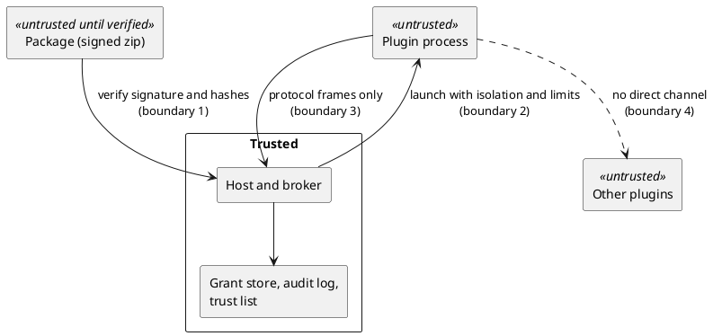

# Sandboxed Plugin Host — Threat model and proof-of-concept review

[← Architecture](architecture.md) · [↑ Overview](README.md) · [Protocol and manifest →](protocol-and-manifest.md)

**Status:** Draft for owner review · **Date:** 2026-10-29

Phase 0 deliverable (REQ-010). Sources: the proving-grounds proof of concept `examples/plugin-sandbox-poc` (read only; its `docs/poc/findings.md`, `escape-results.md` and `escape-matrix.json`), and the planning notes it copies. Nothing was compiled or run for this document; the proof-of-concept results below are its author's own, each from one machine per operating system.

## Contents

- [Assets, actors and boundaries](#assets-actors-and-boundaries)
- [Threats](#threats)
- [Proof-of-concept review](#proof-of-concept-review)
- [Gaps that become backlog items](#gaps-that-become-backlog-items)
- [Sign-off](#sign-off)

### List of Figures

1. [Figure 2 — Trust boundaries](#figure-2)

### List of Tables

1. [Table 4 — Threats and status](#table-4)
2. [Table 5 — Escape matrix of the proof of concept](#table-5)
3. [Table 6 — Gaps](#table-6)

## Assets, actors and boundaries

Assets: the host process and its secrets (environment, tokens, connection strings), the user's files, other plugins and their data, the network the host can reach, the grant store and audit log, and the signing trust list.

Actors: an untrusted plugin author (code the user approved to run, but not to trust), a malicious package from an untrusted source, a plugin that is compromised after install, and a local user who can write to the install folder. The host and the operating system are trusted; kernel and hypervisor escapes are out of scope.

*Figure 2 — Trust boundaries*

Boundary 1 is package to host (signature, hashes, safe paths). Boundary 2 is the operating system isolation. Boundary 3 is the wire protocol and the broker's grant check, the only channel a plugin holds. Boundary 4 is plugin to plugin, which exists only through the host's router.

## Threats

**Table 4 — Threats and status**

| ID | Threat | Mitigation | Status in the PoC |
|----|--------|------------|-------------------|
| T1 | Plugin reads or writes files outside its grants | AppContainer ACLs; bubblewrap mount namespace with a read-only plugin folder | Held on both, with positive controls |
| T2 | Plugin reaches the network or resolves names | No network by default: AppContainer without capabilities; new network namespace | Held on both. Per-host network grants (REQ-007) are not built; the broker must do it |
| T3 | Plugin starts child processes or fork-bombs | Job `ActiveProcessLimit = 1`; seccomp filter on `fork`/`clone` plus `RLIMIT_NPROC` | Held on both |
| T4 | Plugin exhausts memory or CPU | Job memory and CPU rate; `RLIMIT_DATA`, `prlimit` | Memory held on both. CPU held on Windows only (0.37 of a core under a 1% cap on a 32-processor machine). No CPU or cgroup limit on Linux |
| T5 | Plugin reads host secrets from its environment | Minimal explicit environment block | Held after a found leak was fixed |
| T6 | Plugin inherits a handle or descriptor of the host | Explicit handle list (Windows); closing descriptors above 2 before `bwrap` (Linux) | Held. A real leak of a CA-file descriptor was found and fixed. A host without `bash` keeps the Linux leak for descriptors above 9 |
| T7 | Plugin attacks the host or a peer process | Host not visible or not openable; pid namespace; anonymous pipe pairs | Held on both |
| T8 | Plugin outlives the host | Job kill-on-close; `--die-with-parent` | Held on both. One timing flake seen on Linux, not investigated |
| T9 | Plugin spoofs another plugin or the host on the wire | Host stamps `Source` from the channel; only `lifecycle.ready` is accepted from a plugin | Held (chaos mode `spoof`) |
| T10 | Plugin floods, sends oversize or malformed frames, or hangs | Frame cap (1 MiB), strict UTF-8 and JSON parse, rate limit, heartbeat and request time to live, restart policy with a failure ceiling | Held (chaos modes), including a bug the property tests found in UTF-8 validation |
| T11 | Tampered, unsigned or wrongly signed package | Signature over the manifest and per-file hashes; unsafe path, size and id checks | Held for the tested cases. No key revocation, rotation, expiry or chain |
| T12 | Package changed between verification and launch | Read-only installed files; `VerifyInstalled` | Not closed: a writer to the install folder can swap a file in the window. The install folder must be writable by the host only, or the launch must hash what it executes |
| T13 | `entry.dev` or the plain launcher used in production | None in the PoC; the key bypasses packaging | Open. The host must refuse `entry.dev` outside an explicit development mode |
| T14 | Grants persist after uninstall (ACL residue) | Ledger of grants; `Uninstall` revokes them | Held on Windows |
| T15 | Broker confused deputy: a granted call used for more than granted (path traversal, redirect to another host, symlink) | Canonicalise and compare against the grant; never follow links out of a granted folder | Not in the PoC (it has no broker). Needs its own tests |
| T16 | Side channels, covert channels through timing or shared CPU | None | Out of scope for the first version; stated so nobody assumes otherwise |
| T17 | Unprivileged user namespaces disabled (hardened distribution, some CI) | Refuse to start and say why; no silent fallback to the plain launcher | The PoC fails to start inside the default Docker profile. The refusal path is a requirement, not yet written |

## Proof-of-concept review

What it proves: the wire profile (4-byte little-endian length, UTF-8 JSON, 1 MiB cap) carries every behaviour tested, in five languages, with the same checks passing against the stand-in and the real host. The Windows and Linux launchers deny the sixteen and fourteen capabilities in the matrix, each with a positive control so that a broken probe cannot look like a tight sandbox. Packaging verifies signatures and hashes.

What it does not prove: anything about an attack its tests did not think of. The authors say so in the matrix notes, and this review repeats it.

**Table 5 — Escape matrix of the proof of concept**

| Capability | Windows | Linux |
|------------|---------|-------|
| Local service, internet, name resolution | Held | Held |
| Child process, fork without limit | Held | Held |
| Files outside grants, write to read-only grant | Held | Held |
| Host process, host environment, peer plugin | Held | Held |
| Memory limit | Held | Held |
| CPU limit | Held | Unverified |
| Plugin outlives host | Held | Held |
| Inherited handles beyond own pipes | Held | Held |
| Registry write, grants left after uninstall | Held | Not applicable |

Review notes:

- **Linux filter is narrow.** The seccomp program only blocks process creation; every other syscall is open inside the namespaces. A general allow-list (or at least a deny-list of `ptrace`, `mount`, `keyctl`, `bpf`, `perf_event_open`, `io_uring`) belongs in phase 3. `clone3` returns `ENOSYS` so glibc falls back, which is intentional.
- **Docker is not representative.** The Linux run needed `seccomp=unconfined` and `apparmor=unconfined` for bubblewrap to create namespaces. Bare metal, arm64 and macOS are untested; macOS has no launcher.
- **Java does not start in the AppContainer** because path canonicalisation touches parent folders the container cannot read. The Windows launcher therefore does not support Java; it works under bubblewrap. Document it as a platform limit, not a bug to patch around by widening ACLs on `C:\`.
- **Per-user runtimes need a read grant** (Python under `AppData\Local\Programs`). Granting a runtime folder is a trust decision for the user, not a default.
- **`UseLpac` was written and never run; `Detached` lifetime is not implemented.** Neither counts as a mitigation.
- **Blocking pipe reads on the host side** rely on killing the plugin to cancel. A slow-reading plugin cannot stall the host only because the heartbeat timeout kills it; the broker must keep that property.
- **Three separate stdio pipes** are fine for the protocol; the escape tests count them, so a fourth would show up as a failure.
- **Reference sketches in the notes were never compiled** and must not be treated as design evidence. The compiled launchers in `src/` are the evidence.
- **Reuse.** The PoC is the owner's own code, so reuse is open, but the project placement (Q6) decides whether it is copied, referenced or rewritten against dotex conventions.

## Gaps that become backlog items

**Table 6 — Gaps**

| Gap | Threat | Phase |
|-----|--------|-------|
| Broker with grant store, canonicalising path and host checks, audit log | T2, T3, T15 | 2 |
| Per-host network grants through the broker | T2 | 2 |
| `entry.dev` refused outside development mode | T13 | 1 |
| Launch-time hash of the executed file or host-only install folder | T12 | 4 |
| Key revocation, rotation, expiry | T11 | 4 |
| General seccomp allow-list; CPU and cgroup limits on Linux | T4 | 3 |
| Refusal path when namespaces are unavailable | T17 | 3 |
| Investigate the kill-with-host flake | T8 | 3 |
| Escape tests run against packaged plugins, not only the plain launcher | T1, T11 | 4 |

## Sign-off

REQ-010 asks for review before implementation. This document is the draft. The owner signs off by answering Q6 (placement) and confirming the gaps above, after which phase 1 (protocol and manifest schema) starts without launcher code.
