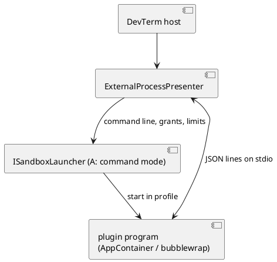

# Launching DevTerm process plugins through the sandbox

**Status:** proposed design, written 2026-11-23; nothing built. The default is recorded as Q31 in [OPEN-QUESTIONS](../../../OPEN-QUESTIONS.md). Parent: [out-of-process-plugins](out-of-process-plugins.md); isolation: [PluginSandbox](../PluginSandbox/README.md).

## Contents

1. [Need](#need)
2. [What exists](#what-exists)
3. [The gap](#the-gap)
4. [Options](#options)
5. [Plan](#plan)
6. [Testing strategy](#testing-strategy)

### List of Figures

1. Figure 1 — Launch paths

### List of Tables

1. Table 1 — Two process protocols today
2. Table 2 — Test plan

## Need

A `process` plugin in DevTerm (Python, Java, Go) runs with the user's full rights once approved. The sandbox library (`OoBDev.System.Sandbox*`: AppContainer on Windows, bubblewrap on Linux) can limit files, network, memory and time, but DevTerm does not use it. Acceptance from the [request](../../features/request/2026-11-10-devterm-out-of-process-plugins-and-control-channel.md): a crash does not stop DevTerm (met), a control client without the token is refused (met, `--controlhttp` bearer token and `CurrentUserOnly` pipe), install asks for approval first (met).

## What exists

**Table 1 — Two process protocols today**

| | DevTerm `process` plugin | Sandbox plugin |
|---|---|---|
| Wire | JSON lines on stdin and stdout, `hello` then `render` | packed binary frames, broker requests and replies |
| Program | any command line from `plugin.json` | a .NET plugin assembly started by the launcher |
| Isolation | none; approval and content hash only | AppContainer or bubblewrap, limits from the manifest |
| Host class | `ExternalProcessPresenter`, `LazyExternalPresenter` | `ISandboxLauncher` |

*Table 1 shows why the two cannot be joined by swapping `Process.Start`: the program and the protocol both differ.*

## The gap

`ExternalProcessPresenter` starts the child with `Process.Start` and speaks JSON lines. The sandbox launchers start only their own plugin host program and speak frames. A sandboxed non-.NET presenter therefore needs either the launcher to start an arbitrary command line, or the plugin to speak the frame protocol.

## Options

- **A. Launcher runs an arbitrary command (recommended).** Add a "run this command line inside the same profile" entry to the launchers (profile, folder grants and limits from the `plugin.json` permissions block), keep the JSON-lines protocol on stdio. Smallest change for plugin authors (existing Python, Java and Go examples keep working); the sandbox work is in the launchers, which already own the profile code. Trade-off: the sandbox library gains a second, simpler plugin kind with no broker.
- **B. Port the presenter protocol to frames.** Plugins speak the sandbox frame protocol and gain the broker. One protocol, but every example and the three languages need a frame codec, and the broker has nothing to offer a presenter.
- **C. Keep unsandboxed, warn.** Approval at install only. No work, no isolation.

*Figure 1 — Launch paths (option A)*

## Plan

Option A, in order, each step its own change:

1. `PluginManifest` gets an optional `permissions` block (folders, network, memory, cpu, wall time) reusing the sandbox manifest field names; absent means today's behaviour.
2. The sandbox launchers get `StartCommand(commandLine, profile)` returning the redirected streams; Windows and Linux first, macOS deferred like the rest of the sandbox.
3. `ExternalProcessPresenter` takes an `IProcessStarter`; the default is `Process.Start`, the sandboxed one is used when `permissions` is present, and approval shows the grants.
4. A plugin with `permissions` on a platform without a launcher is refused, not run unsandboxed.

## Testing strategy

**Table 2 — Test plan**

| Case | Tier | Check |
|------|------|-------|
| manifest with and without `permissions` | Unit | parsed; absent keeps the plain starter |
| `IProcessStarter` swap | Unit | presenter handshake and fault handling unchanged |
| sandboxed Python reads outside its grants | Integration (Linux container with bubblewrap) | denied |
| sandboxed plugin exceeds wall time | Integration | ended, presenter marked faulted, session carries on |
| refusal on an unsupported platform | Unit | not started |

*Table 2 maps each case to its tier; the AppContainer checks run on the Windows host as Hardware-free Unit or Simulate tests where the existing sandbox tests do.*
