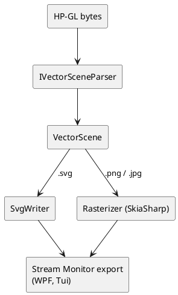

# Raster export of rendered content

Decided 2026-10-13: raster export (PNG, JPG) is a core service that every front end calls, not something each rendering presenter implements ([presenters.md](presenters.md)). This document defines the contract it needs. Designed 2026-11-09; not built yet (waits on [OPEN-QUESTIONS Q2](../../../OPEN-QUESTIONS.md)).

## Contents

- [Problem](#problem)
- [Design](#design)
- [Migration plan](#migration-plan)
- [Testing strategy](#testing-strategy)
- [Completion checklist](#completion-checklist)

## Problem

Today the only renderable content is HP-GL, and `HpglToSvgConverter` parses and writes SVG in one pass, so nothing else can reuse the parse. The WPF and Tui front ends cannot show or save a bitmap without each owning a renderer. PostScript and PCL go through external tools (`StreamCaptureConverter`), which already produce PNG and need no part of this.

## Design

Split "parse" from "write", with a small scene in between.

- **`VectorScene`** (immutable): width, height and a list of `VectorPolyline` (pen number, colour `#RRGGBB`, points in scene units with Y already pointing down). It is what `HpglToSvgConverter` computes today before `Render`.
- **`IVectorSceneParser`**: bytes in, `VectorScene` out. HP-GL is the first; a telemetry plot presenter is the second consumer named in presenters.md.
- **`VectorSceneSvgWriter`**: the current `Render` moved out unchanged, so the SVG output stays byte-identical (the existing converter tests are the proof).
- **`VectorSceneRasterizer`**: `Rasterize(scene, widthPixels, format)` returns PNG or JPEG bytes using SkiaSharp (already a repository package, used by `OoBDev.Extensions.Drawing`). It scales to the requested width and keeps the aspect ratio, white background, anti-aliased 1 px strokes.
- Front ends call the rasterizer and write the bytes: the Stream Monitor export action gains PNG and JPG beside SVG; WPF and the Tui share the same call (the Tui only lists the file, as it does for SVG).

*Figure 1 — parse once, write SVG or raster from the same scene*

## Migration plan

| Item | Current | Target | Namespace | Unit | References that change |
|------|---------|--------|-----------|------|------------------------|
| `VectorScene`, `VectorPolyline`, `IVectorSceneParser`, SVG writer | inside `HpglToSvgConverter` (`Framework/OoBDev.Documents.Hpgl`) | `Framework/OoBDev.Documents.Hpgl` (recommended, see Q2) | `OoBDev.Documents.Hpgl` | existing package | none |
| `VectorSceneRasterizer` | does not exist | `Extensions/OoBDev.Extensions.Drawing` (already references SkiaSharp) | `OoBDev.Extensions.Drawing` | existing package | `OoBDev.DevTerm.Core` references it for export |

No new project is created. The scene sits in the Framework library because it has no Skia dependency; only the rasterizer pulls Skia, and it lives in an Extensions library, as the layer rules require (Framework depends only on Common).

## Testing strategy

- Unit: scene parse equals the old SVG path data (existing HP-GL tests unchanged); rasterizer output decodes to the expected size and has non-white pixels where a known line is drawn; an empty scene gives a blank bitmap; a zero or oversize width is rejected.
- Screenshot guide: a captured HP-GL stream exported to PNG, referenced from the Stream Monitor user guide.

## Completion checklist

- [x] Contract and migration plan written
- [ ] Owner confirms the plan (Q2)
- [ ] Scene split with unchanged SVG output
- [ ] Rasterizer with tests
- [ ] Export action in WPF and Tui, guide entry
