# Modular Profile Management - Architecture Design

**Epic:** 07 - Identity & Session Management
**Feature:** 04 - Modular Profile Management
**Status:** Proposed
**Last Updated:** 2026-01-22

---

## Architecture Overview

The Modular Profile Management system provides an extensible framework for managing user and organizational profiles through composable, independently validated, and versioned profile modules. The architecture emphasizes flexibility, type safety, and storage abstraction while maintaining comprehensive audit trails.

### Design Principles

1. **Modularity**: Profile data organized into independent, composable modules
2. **Extensibility**: New modules added via dependency injection without core changes
3. **Type Safety**: Strongly-typed module data with compile-time validation
4. **Storage Flexibility**: Multiple storage backends (SQL, NoSQL, blob) per module
5. **Version Everything**: Complete audit trail of all profile changes
6. **Privacy by Design**: Granular visibility controls on modules and fields
7. **Validation Independence**: Each module validates its own data independently
8. **Performance**: Lazy loading, caching, and optimized storage queries

---

## System Context

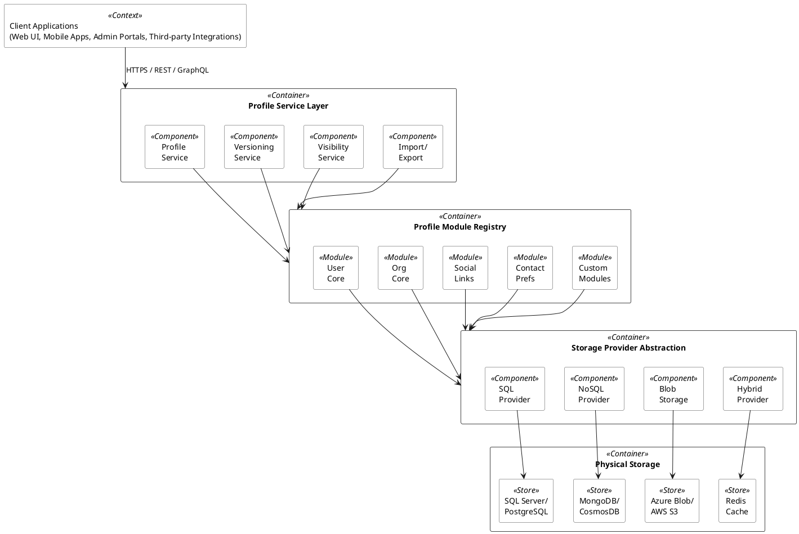

*Figure 1 — System context*

### External Dependencies

- **Identity System**: User/organization IDs, authentication context
- **Caching Layer**: Module data caching, completeness score caching
- **Blob Storage**: Avatars, documents, large binary attachments
- **Search Engine**: Profile discovery and full-text search (optional)
- **Analytics Service**: Profile metrics and insights (optional)

---

## Component Architecture

### Core Components

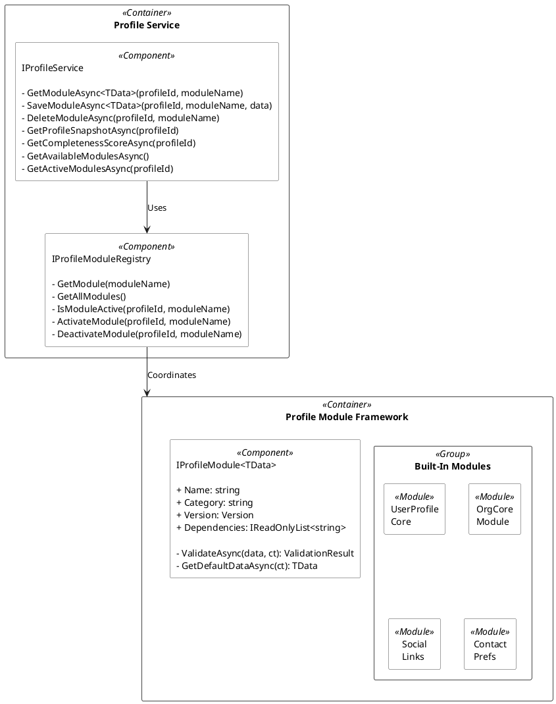

*Figure 2 — Core components*

### Storage Layer

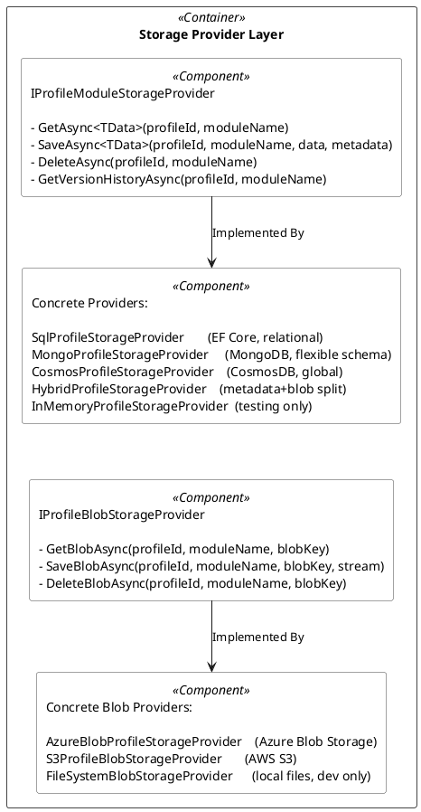

*Figure 3 — Storage layer*

### Versioning and Audit

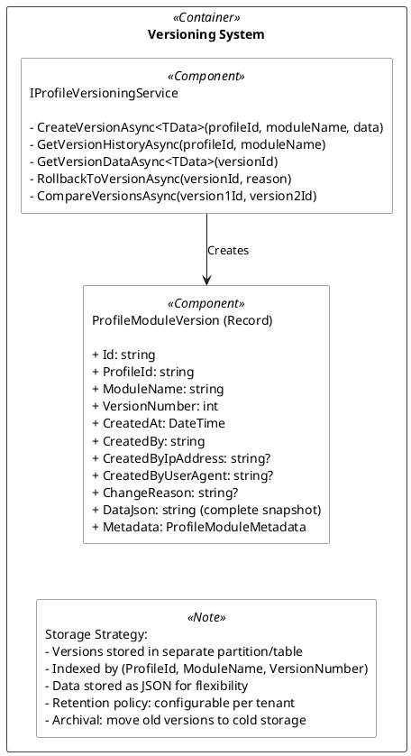

*Figure 4 — Versioning and audit*

### Validation Framework

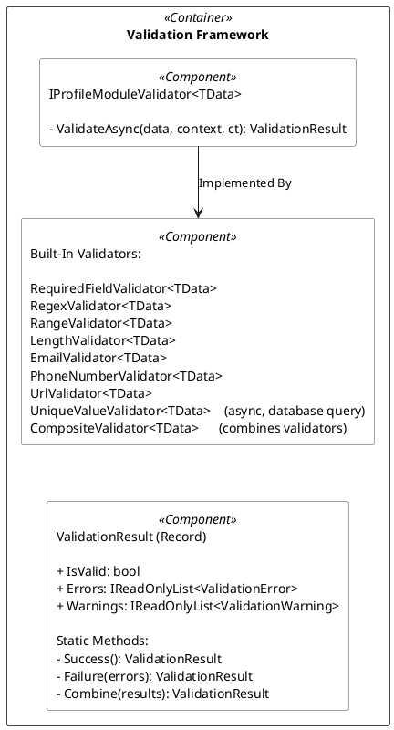

*Figure 5 — Validation framework*

### Visibility and Privacy

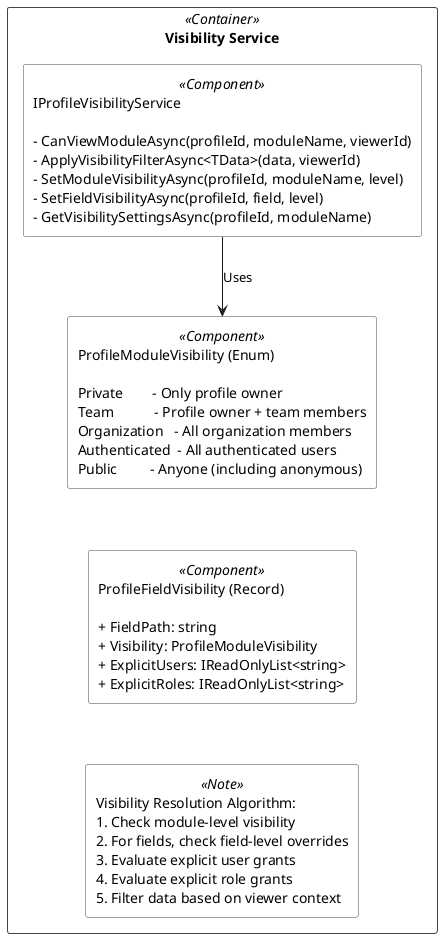

*Figure 6 — Visibility and privacy*

---

## Data Flow

### Profile Module Save Operation

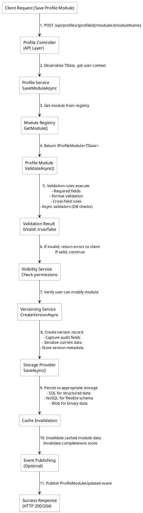

*Figure 7 — Profile module save operation*

### Profile Snapshot Retrieval

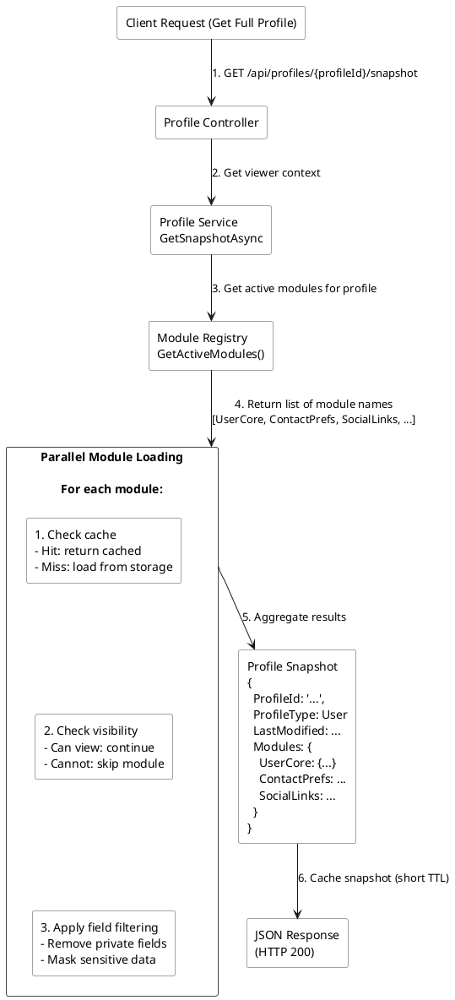

*Figure 8 — Profile snapshot retrieval*

### Profile Completeness Calculation

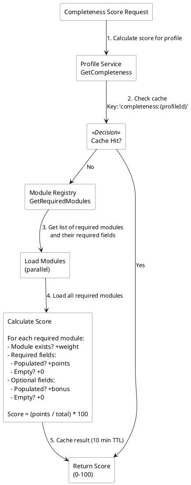

*Figure 9 — Profile completeness calculation*

---

## Module Registration and Discovery

### Module Registration Flow

```csharp
// Startup.cs / Program.cs
public void ConfigureServices(IServiceCollection services)
{
    // 1. Register core profile services
    services.AddProfileManagement(options =>
    {
        options.DefaultCacheTtl = TimeSpan.FromMinutes(5);
        options.EnableVersioning = true;
        options.EnableAuditLog = true;
    });

    // 2. Register storage providers
    services.AddProfileStorageProvider<SqlProfileStorageProvider>(options =>
    {
        options.ConnectionString = configuration.GetConnectionString("ProfileDb");
    });

    services.AddProfileBlobStorage<AzureBlobProfileStorageProvider>(options =>
    {
        options.ConnectionString = configuration["Azure:BlobStorage"];
        options.ContainerName = "profile-blobs";
    });

    // 3. Register built-in modules (auto-discovered)
    services.AddBuiltInProfileModules();

    // 4. Register custom modules
    services.AddProfileModule<UserSkillsModule, UserSkillsData>(options =>
    {
        options.StorageProvider = typeof(NoSqlProfileStorageProvider);
        options.DefaultVisibility = ProfileModuleVisibility.Organization;
    });

    services.AddProfileModule<CompanyBrandingModule, CompanyBrandingData>(options =>
    {
        options.StorageProvider = typeof(HybridProfileStorageProvider);
        options.BlobStorageProvider = typeof(AzureBlobProfileStorageProvider);
    });
}
```

### Module Discovery Process

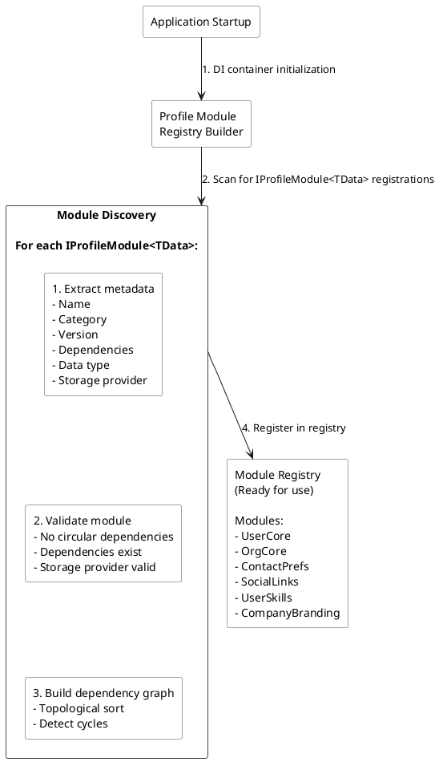

*Figure 10 — Module discovery process*

---

## Storage Provider Selection

### Storage Strategy Decision Tree

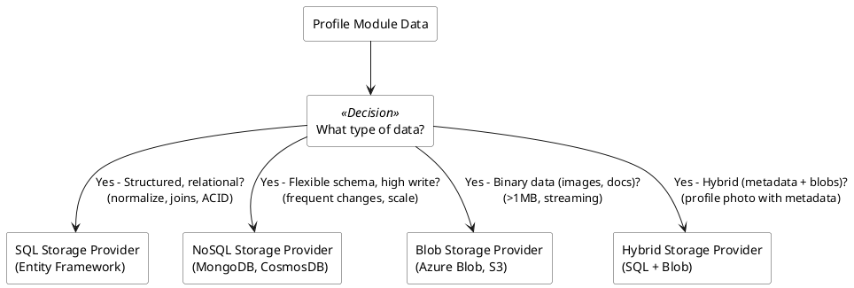

*Figure 11 — Storage strategy decision tree*

### Storage Provider Configuration

```csharp
// Example: User Core Module (SQL)
public class UserProfileCoreModule : IProfileModule<UserProfileCoreData>
{
    public string Name => "UserCore";
    public string Category => ProfileModuleCategories.Personal;
    public Version Version => new(1, 0, 0);
    public IReadOnlyList<string> Dependencies => [];

    // Storage provider: SQL (structured, relational)
    public Type StorageProvider => typeof(SqlProfileStorageProvider);

    public async Task<ValidationResult> ValidateAsync(
        UserProfileCoreData data,
        CancellationToken ct)
    {
        var validator = new CompositeValidator<UserProfileCoreData>(
            new RequiredFieldValidator<UserProfileCoreData>(d => d.FirstName),
            new RequiredFieldValidator<UserProfileCoreData>(d => d.LastName),
            new EmailValidator<UserProfileCoreData>(d => d.Email),
            new UniqueValueValidator<UserProfileCoreData>(d => d.Email)
        );

        return await validator.ValidateAsync(data, ct);
    }

    public Task<UserProfileCoreData> GetDefaultDataAsync(CancellationToken ct)
    {
        return Task.FromResult(new UserProfileCoreData());
    }
}

// Example: Company Branding Module (Hybrid: SQL + Blob)
public class CompanyBrandingModule : IProfileModule<CompanyBrandingData>
{
    public string Name => "CompanyBranding";
    public string Category => ProfileModuleCategories.Organization;
    public Version Version => new(1, 0, 0);
    public IReadOnlyList<string> Dependencies => ["OrgCore"];

    // Storage provider: Hybrid (metadata in SQL, logo in blob)
    public Type StorageProvider => typeof(HybridProfileStorageProvider);
    public Type BlobStorageProvider => typeof(AzureBlobProfileStorageProvider);

    // Logo, banner stored as blobs
    // Colors, fonts stored as JSON in SQL
}
```

---

## Caching Strategy

### Multi-Level Caching

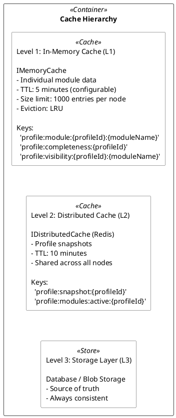

*Figure 12 — Multi-level cache hierarchy*

### Cache Invalidation Strategy

```csharp
// On module save/update
public async Task SaveModuleAsync<TData>(
    string profileId,
    string moduleName,
    TData data,
    CancellationToken ct) where TData : class
{
    // 1. Save to storage
    await _storageProvider.SaveAsync(profileId, moduleName, data, ct);

    // 2. Invalidate L1 cache (local node)
    _memoryCache.Remove($"profile:module:{profileId}:{moduleName}");
    _memoryCache.Remove($"profile:completeness:{profileId}");

    // 3. Invalidate L2 cache (distributed)
    await _distributedCache.RemoveAsync($"profile:snapshot:{profileId}", ct);
    await _distributedCache.RemoveAsync($"profile:modules:active:{profileId}", ct);

    // 4. Publish cache invalidation event (for other nodes)
    await _eventBus.PublishAsync(new ProfileModuleCacheInvalidated
    {
        ProfileId = profileId,
        ModuleName = moduleName,
        Timestamp = DateTime.UtcNow
    }, ct);
}
```

---

## Security Architecture

### Access Control Flow

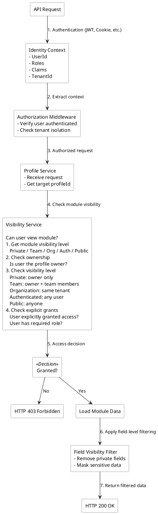

*Figure 13 — Access control flow*

### Data Encryption

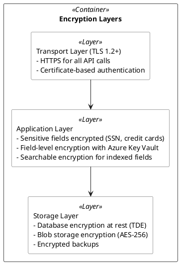

*Figure 14 — Encryption layers*

---

## Error Handling

### Error Handling Strategy

```csharp
// Profile service with comprehensive error handling
public class ProfileService : IProfileService
{
    public async Task SaveModuleAsync<TData>(
        string profileId,
        string moduleName,
        TData data,
        string? changeReason,
        CancellationToken ct) where TData : class
    {
        try
        {
            // 1. Validate input
            if (string.IsNullOrEmpty(profileId))
                throw new ArgumentException("Profile ID is required", nameof(profileId));

            if (string.IsNullOrEmpty(moduleName))
                throw new ArgumentException("Module name is required", nameof(moduleName));

            if (data == null)
                throw new ArgumentNullException(nameof(data));

            // 2. Get module
            var module = await _moduleRegistry.GetModuleAsync(moduleName, ct);
            if (module == null)
                throw new ProfileModuleNotFoundException(moduleName);

            // 3. Validate data
            var validationResult = await module.ValidateAsync(data, ct);
            if (!validationResult.IsValid)
                throw new ProfileModuleValidationException(
                    moduleName,
                    validationResult.Errors
                );

            // 4. Check permissions
            var canModify = await _visibilityService.CanModifyModuleAsync(
                profileId,
                moduleName,
                _currentUser.UserId,
                ct
            );
            if (!canModify)
                throw new UnauthorizedProfileAccessException(
                    profileId,
                    moduleName,
                    "modify"
                );

            // 5. Save with retry logic
            await _retryPolicy.ExecuteAsync(async () =>
            {
                // Create version
                await _versioningService.CreateVersionAsync(
                    profileId,
                    moduleName,
                    data,
                    _currentUser.UserId,
                    changeReason,
                    ct
                );

                // Save to storage
                await _storageProvider.SaveAsync(
                    profileId,
                    moduleName,
                    data,
                    module.Metadata,
                    ct
                );
            });

            // 6. Invalidate cache
            await InvalidateCacheAsync(profileId, moduleName, ct);

            // 7. Publish event
            await _eventBus.PublishAsync(new ProfileModuleUpdated
            {
                ProfileId = profileId,
                ModuleName = moduleName,
                UpdatedAt = DateTime.UtcNow,
                UpdatedBy = _currentUser.UserId
            }, ct);
        }
        catch (ProfileModuleNotFoundException ex)
        {
            _logger.LogWarning(ex, "Module not found: {ModuleName}", moduleName);
            throw;
        }
        catch (ProfileModuleValidationException ex)
        {
            _logger.LogWarning(ex, "Validation failed for module: {ModuleName}", moduleName);
            throw;
        }
        catch (UnauthorizedProfileAccessException ex)
        {
            _logger.LogWarning(ex,
                "Unauthorized access to profile {ProfileId}, module {ModuleName}",
                profileId, moduleName);
            throw;
        }
        catch (StorageException ex)
        {
            _logger.LogError(ex,
                "Storage error saving profile {ProfileId}, module {ModuleName}",
                profileId, moduleName);
            throw new ProfileServiceException(
                "Failed to save profile module",
                ex
            );
        }
        catch (Exception ex)
        {
            _logger.LogError(ex,
                "Unexpected error saving profile {ProfileId}, module {ModuleName}",
                profileId, moduleName);
            throw new ProfileServiceException(
                "An unexpected error occurred",
                ex
            );
        }
    }
}
```

---

## Performance Optimization

### Optimization Strategies

1. **Lazy Loading**
   - Load modules only when requested
   - Don't load entire profile if only one module needed
   - Use projection queries for metadata-only requests

2. **Caching**
   - Two-level cache (memory + distributed)
   - Cache module data with short TTL (5 min)
   - Cache completeness scores with longer TTL (10 min)
   - Cache visibility settings (rarely change)

3. **Parallel Loading**
   - Load multiple modules in parallel for snapshots
   - Use `Task.WhenAll()` for concurrent operations
   - Limit parallelism to avoid overwhelming storage

4. **Database Optimization**
   - Index on (ProfileId, ModuleName) for fast lookups
   - Index on (ProfileId, ModuleName, VersionNumber) for version queries
   - Partition large tables by ProfileType or TenantId
   - Use read replicas for query operations

5. **Blob Storage Optimization**
   - Use CDN for frequently accessed blobs (avatars)
   - Generate SAS tokens for direct browser upload/download
   - Resize images on upload (multiple sizes)
   - Lazy-load blob URLs (don't fetch blob data on profile load)

6. **Serialization**
   - Use System.Text.Json (faster than Newtonsoft.Json)
   - Configure serializer for performance (ignore nulls, camel case)
   - Cache serialization descriptors

---

## Deployment Architecture

### Multi-Tenant Deployment

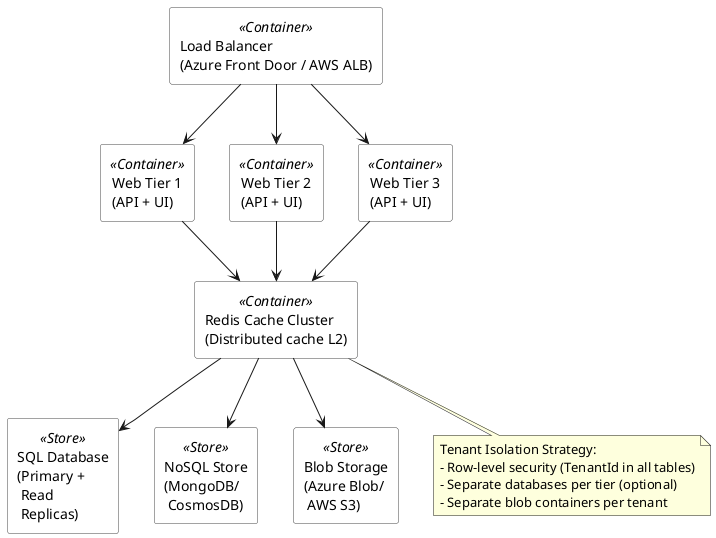

*Figure 15 — Multi-tenant deployment*

---

## Future Enhancements

1. **GraphQL Support**
   - GraphQL schema for profile queries
   - Field-level resolvers with visibility checks
   - Batching and caching

2. **Real-Time Sync**
   - SignalR for live profile updates
   - Optimistic UI updates
   - Conflict resolution

3. **AI-Powered Features**
   - Profile completeness suggestions
   - Automatic data enrichment
   - Duplicate detection

4. **Advanced Search**
   - ElasticSearch integration
   - Faceted search
   - Relevance ranking

5. **Mobile Offline Support**
   - Local storage with sync
   - Conflict resolution
   - Delta updates

---

## References

- Entity Framework Core 10.0 Documentation
- Azure Blob Storage Best Practices
- Redis Caching Strategies
- GDPR Data Portability Requirements
- JSON Schema Specification
