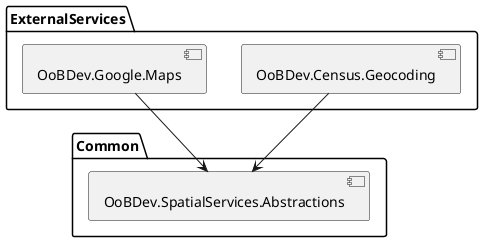

# Spatial services (geocoding)

Status: **proposed design, written 2026-11-19 on the assumed answer A of Q19 (waits for a consumer; Bing Maps dropped because it is being retired); abstractions and the Census adapter built 2026-11-19 (5 unit tests); `OoBDev.SpatialServices` `GeoMath` (distance, bearing, destination; 9 unit tests) built 2026-11-23; other adapters, cache decorator and fallback chain not built.** Request: [spatial services](../../features/request/2026-11-10-spatial-services.md). Epic 3 of [SharedFramework](../SharedFramework/README.md).

## Contents

1. [Behavior](#behavior)
2. [Architecture](#architecture)
3. [API sketch](#api-sketch)
4. [Rules](#rules)
5. [Testing strategy](#testing-strategy)
6. [Open points](#open-points)

### List of Figures

1. Figure 1 — Components

### List of Tables

1. Table 1 — Test plan

## Behavior

Turn an address into a global position and back, with a result quality, through one contract and swappable vendors. The vendor is chosen by configuration with `TryAddConfiguredKeyedService<T>` (key kebab-case: `census`, `google-maps`). A failed or empty lookup returns a result with quality `None`, never a thrown vendor exception.

## Architecture



*Figure 1 — Components*

Adapters reference Abstractions only and use `IHttpClientFactory` (no vendor SDK). Bing Maps is not carried over. The Census geocoder needs no key and is the default; Google needs a key from configuration (validated options, never logged).

## API sketch

```csharp
public enum ResultQuality { None, Approximate, Interpolated, Rooftop }
public sealed record GlobalPosition(double Latitude, double Longitude);
public sealed record AddressQuery(string Line1, string? Line2, string? City, string? Region, string? PostalCode, string? Country);
public sealed record GeocodeResult(GlobalPosition? Position, ResultQuality Quality, string? NormalizedAddress);

public interface ILocationServices
{
    Task<GeocodeResult> GeocodeAsync(AddressQuery address, CancellationToken cancellationToken);
    Task<GeocodeResult> ReverseGeocodeAsync(GlobalPosition position, CancellationToken cancellationToken);
}
```

## Rules

- Latitude within -90..90 and longitude within -180..180, checked before a call.
- The adapter honours the vendor rate limit and terms (the Census service is free but rate limited; Google bills per call), so results are not cached by the adapter; a caching decorator is a separate, optional piece using the shared cache design.

## Testing strategy

**Table 1 — Test plan**

| Case | Tier | Check |
|------|------|-------|
| response mapping per vendor | Unit (recorded JSON, fake `HttpMessageHandler`) | position, quality and normalized address |
| no match, vendor error, timeout | Unit | quality `None`, no exception |
| invalid coordinates | Unit | rejected before the call |
| Census live lookup | LiveIntegration | one known address |
| Google live lookup | LiveIntegration | needs a key in test parameters |

*Table 1 maps each case to its tier; the adapters have no emulator, so live tests stay manual.*

## Open points

Whether any consumer needs reverse geocoding or routing; routing is out of scope. The vendor list waits for the first consumer.
