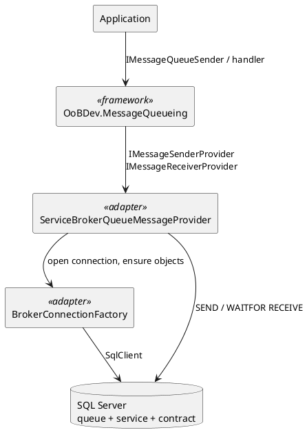

# SQL Server Service Broker — Architecture

[← Requirements](requirements.md) · [↑ Overview](README.md) · [API design →](api-design.md)

**Status:** Draft · **Date:** 2026-10-29

## Contents

- [Components](#components)
- [Alternatives considered](#alternatives-considered)

### List of Figures

1. [Figure 1 — Components](#figure-1)

### List of Tables

1. [Table 2 — Alternatives](#table-2)

## Components

The adapter follows `OoBDev.RabbitMQ`: it references only `OoBDev.MessageQueueing.Abstractions`, `OoBDev.AsyncApi` and `OoBDev.System.Abstractions`, plus `Microsoft.Data.SqlClient`.

*Figure 1 — Components*

Send: open a connection, `BEGIN DIALOG` to the target service, `SEND ON CONVERSATION` with the JSON body as `varbinary(max)`, end the conversation when the contract has a single message. Receive: a transaction per message, `WAITFOR (RECEIVE TOP (1) … FROM queue), TIMEOUT`, deserialize, call the handler provider, commit; on exception roll back and count retries by message id in memory, `END CONVERSATION … WITH ERROR` past the limit.

## Alternatives considered

**Table 2 — Alternatives**

| Alternative | Why not |
|-------------|---------|
| Reuse the proving-grounds prototypes | 2008-era, book-derived, licence unchecked; written fresh instead |
| A table-based queue with `SKIP LOCKED`-style polling | Not Service Broker, and the request is for the broker |
| Add the code to the existing SQL Server adapters | Messaging adapters are one project per technology |

[API design →](api-design.md)
