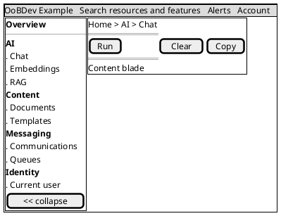
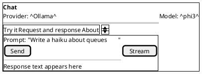

# Example UI: Shell and Navigation Design

Part of [future-example.md](../../../future-example.md). Next: [screen designs](screens.md).

## Contents

- [Layout](#layout)
- [Navigation groups](#navigation-groups)
- [Blade pattern](#blade-pattern)
- [Conventions](#conventions)

## Layout

The shell follows the Azure portal: a fixed top bar, a collapsible left navigation, a breadcrumb row and a content area made of blades.

*Figure 1 — Portal shell*

## Navigation groups

Table 1 is the target. The navigation in `src/layout/nav.ts` lists a screen once it is built (Table 2), so groups differ until the remaining screens exist.

**Table 1 — Left navigation (target)**

| Group | Entries |
|---|---|
| Overview | Dashboard, Operations |
| AI | Chat, Ollama, Groq, Embeddings, Image embeddings, RAG, Semantic Kernel |
| Content | Documents, Text tools, Templates, Converters |
| Messaging | Communications, Queues, Queue adapters, Blob storage |
| Data | Search, Vector stores, Vectors and matrices, Data access, Cache |
| Identity and security | Current user, Identity management, Security helpers |
| Compute and formats | Expression calculator, Pipelines, Archives and formats |
| Developer | API reference, Event reference, Telemetry, CLI tools |

**Table 2 — Left navigation as built (`src/layout/nav.ts`)**

| Group | Entries |
|---|---|
| AI | Chat, Embeddings, Retrieval (RAG), Ollama, Groq cloud, Image labels, Model compare |
| Content | Documents, Templates |
| Data | Cache lab |
| Utilities | Toolbox, Text tools, Vector store, Vector lab |
| Messaging | Communications, Queues |
| Identity and security | Current user |
| Operations | Runtime and configuration, Telemetry |
| Developer | API reference, Event reference |

The Overview group is the home page (`OverviewPage`), not a navigation group.

## Blade pattern

Every feature page is one resource blade:

- **Header:** title, subtitle and a status chip (provider reachable or not, from the health endpoint).
- **Command bar:** the page's commands, each a command class that can be disabled by its own `canExecute`.
- **Tabs:** Try it, Request and response, About (links to the matching README and design docs).
- **Result area:** typed result, raw JSON toggle, copy, and elapsed time.

*Figure 2 — Blade with tabs*

## Conventions

- **Auth:** all routes require sign in when Keycloak is on; the user menu shows claims and sign out.
- **Errors:** RFC 9457 problem details shown in a toast with a details link; validation errors land beside the field.
- **Loading:** skeletons for blades, progress for long calls, cancel for streams.
- **Theme:** light and dark tokens defined once; no hard-coded colors in components.
- **Accessibility:** every control reachable by keyboard; navigation is a landmark; status is never color only.
- **State:** Pinia stores hold session data only; nothing sensitive is persisted in browser storage. Tokens are kept in memory.
- **Commands:** each user action is a class implementing `execute(): Promise<void>` and `canExecute: boolean`, injected with its service. View-model composables expose them to the template.

[Back to the plan](../../../future-example.md)
