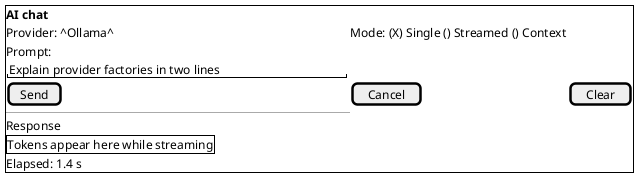
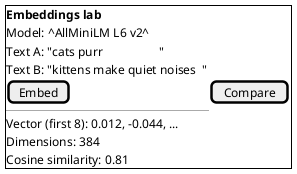
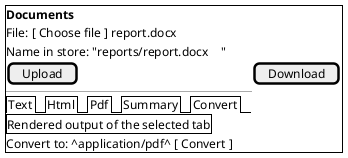
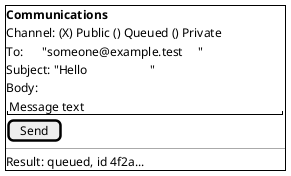
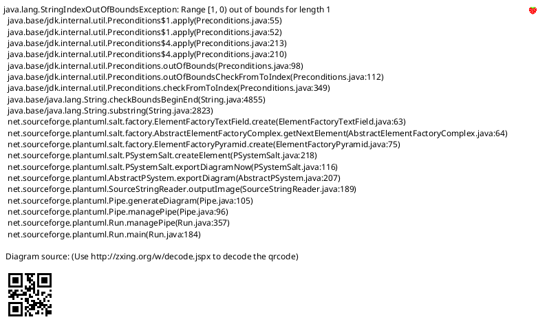
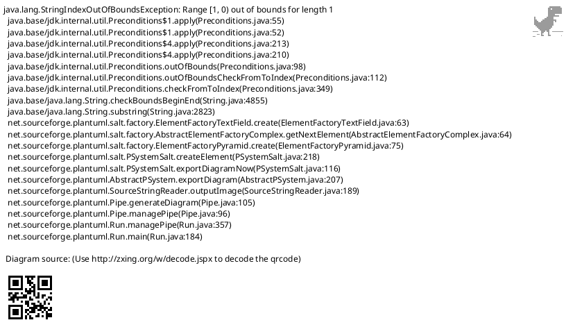
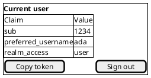
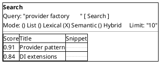

# Example UI: Screen Designs

Part of [future-example.md](../../../future-example.md). Back to the [shell design](README.md).

Each screen lists its purpose, the API it binds to, its commands and a mockup. "New" in the API column means the endpoint does not exist yet (see the phases in the plan).

## Contents

- [Screen index](#screen-index)
- [AI chat](#ai-chat)
- [Embeddings lab](#embeddings-lab)
- [Documents workbench](#documents-workbench)
- [Communications composer](#communications-composer)
- [Queues](#queues)
- [Templates](#templates)
- [Current user](#current-user)
- [Search](#search)
- [Remaining screens](#remaining-screens)

## Screen index

**Table 1 — Screens and their APIs**

| Screen | Route | API | Status |
|---|---|---|---|
| Dashboard | `/` | health, links | New |
| AI chat | `/ai/chat` | `POST api/AI`, `Streamed`, `Context` | Exists |
| Ollama console | `/ai/ollama` | `api/Ollama` | Exists |
| Groq console | `/ai/groq` | `api/GroqCloud/Completion` | Exists (key needed) |
| Embeddings lab | `/ai/embeddings` | `api/AI/Embeddings`, `api/SBERT`, `api/AllMiniLM` | Exists |
| RAG | `/ai/rag` | `api/AI/RaggedAnne` | Exists |
| Documents | `/content/documents` | `Document/*` | Exists |
| Templates | `/content/templates` | `api/TextTemplate/*` | Partly |
| Communications | `/messaging/communications` | `api/Communications/*` | Exists |
| Queues | `/messaging/queues` | `api/MessageQueueing/*` | Exists |
| Current user | `/identity/me` | `api/User/claims` | Exists |
| Search | `/data/search` | `Search/*` | Restore |
| Cache | `/data/cache` | cache endpoints | New |
| Vector stores | `/data/vectors` | vector store endpoints | New |
| Image embeddings | `/ai/images` | image endpoints | New |
| Vectors and matrices | `/data/matrices` | vector math endpoints | New |
| Identity management | `/identity/users` | identity endpoints | New |
| Expression calculator | `/compute/expressions` | expression endpoints | New |
| Security helpers | `/security/tools` | hash, HMAC, TOTP endpoints | New |
| Operations | `/ops` | health, configuration | New |

## AI chat

Purpose: send a prompt to the configured generative provider, optionally streamed, with optional context documents.

Commands: `SendPromptCommand`, `StreamPromptCommand` (cancellable), `ClearCommand`.

*Figure 1 — AI chat*

## Embeddings lab

Purpose: turn text into a vector with each available model and compare them. Commands: `EmbedCommand`, `CompareCommand`.

*Figure 2 — Embeddings lab*

## Documents workbench

Purpose: upload a file, view it as text, HTML, PDF or summary, or convert between types. Commands: `UploadCommand`, `ConvertCommand`, `DownloadCommand`.

*Figure 3 — Documents workbench*

## Communications composer

Purpose: send a message through the public, queued or private channel. Commands: `SendMessageCommand` with a channel option.

*Figure 4 — Communications composer*

## Queues

Purpose: send a sample message to the public or private queue and show the AsyncAPI contract for it. Commands: `EnqueueCommand`.

*Figure 5 — Queue sender*

## Templates

Purpose: pick a template, supply JSON data and render it. The list comes from `SupportedTemplates`; save and query are Phase 3. Commands: `ApplyTemplateCommand`.

*Figure 6 — Template runner*

## Current user

Purpose: show who the token says you are. Binds to `GET api/User/claims`; the same data feeds the top-bar user menu.

*Figure 7 — Claims*

## Search

Purpose: lexical, semantic and hybrid search over indexed content, with a list-all mode. Needs the commented-out `SearchController` restored. Commands: `SearchCommand`.

*Figure 8 — Search*

## Remaining screens

These follow the same blade pattern; each gets its own four design documents (requirements, architecture, API design, testing strategy) when the phase starts.

**Table 2 — Remaining screens**

| Screen | Key controls | Notes |
|---|---|---|
| Dashboard | provider status tiles, recent activity, links | Reads a new health endpoint |
| Ollama and Groq consoles | model list, completion, stream | Groq disabled until a key is configured |
| RAG | question box, cited passages | Binds to `RaggedAnne` |
| Cache | key list, get, set, remove, flush | Provider switch for Redis or in-memory |
| Vector stores | collection list, upsert, query | Qdrant and OpenSearch |
| Image embeddings | image drop zone, vector, labels | CLIP zero-shot labels, DINOv2 and ViT compare |
| Vectors and matrices | vector and matrix inputs, operators | Mirrors the SQL functions |
| Identity management | user search, rights, sessions | Keycloak admin scope required |
| Expression calculator | expression box, variables, result | Shows the parsed tree |
| Security helpers | hash, HMAC, one-time code | SHA-512 default |
| Queue adapters and blob storage | provider status, container browser | Azurite and Moto in the stack |
| Data access | query runner, DacPac build | Read-only by default |
| Semantic Kernel | plug-in list, invoke | |
| Text tools | Markdown, HTML, YAML converters | |
| Formats | file inspector | Device and hardware screens are deferred until the hardware projects are merged |
| Operations | health, configuration | Secrets masked |
| Developer | links to Scalar, AsyncAPI, Grafana, CLI catalog | |

[Back to the plan](../../../future-example.md) · [Shell design](README.md)
