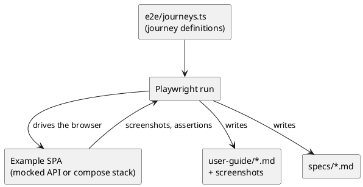

# Example application documentation

The example application (`src/Examples/OoBDev.Example.Web` and `OoBDev.Example.WebApi`) shows how the framework features are used. This folder holds the user guides, the journey specifications and the notes on how both are produced.

## Contents

- [Documents](#documents)
- [How the pieces fit](#how-the-pieces-fit)
- [Regenerating](#regenerating)

## Documents

**Table 1 — Documents in this folder**

| Document | What it holds | Written by |
| --- | --- | --- |
| [user-guide/](user-guide/README.md) | Step-by-step guides with a screenshot per step | Generated by the end-to-end run |
| [specs/](specs/README.md) | Acceptance criteria per journey | Generated by the end-to-end run |
| [deployment.md](deployment.md) | Running the example stack: commands, services, ports | By hand |
| [testing.md](testing.md) | How the journeys, screenshots and guides are produced | By hand |
| [../design/example-ui/README.md](../design/example-ui/README.md) | Shell and screen designs | By hand |
| [../../future-example.md](../../future-example.md) | Plan and checklist | By hand |

## How the pieces fit

A journey is defined once in `e2e/journeys.ts`. One run of the Playwright tests walks it, takes the screenshots, and rewrites the guide and the spec from the same definition, so the documents cannot drift from the application.



*Figure 1 — From journey definition to guide and spec*

## Regenerating

```powershell
cd src/Examples/OoBDev.Example.Web
npm run e2e
```

Run `scripts/examples/verify-example-web.ps1` to do this plus the unit tests and build, and to fail when the docs drift. Then review the diff in `docs/example`: changed screenshots show UI changes, changed text shows journey changes. See [testing.md](testing.md) for running against the compose stack.
