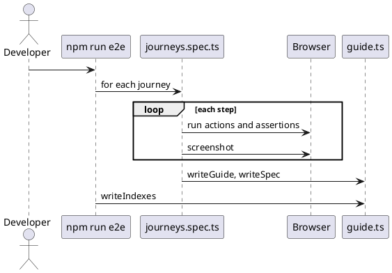

# End-to-end journeys and generated guides

[Example documentation](README.md)

## Contents

- [Approach](#approach)
- [Writing a journey](#writing-a-journey)
- [Mocked and live runs](#mocked-and-live-runs)
- [Output](#output)
- [Local check instead of CI](#local-check-instead-of-ci)

## Approach

Playwright drives the SPA in Chromium at 1280 x 800. Each journey is one test; each step performs its actions, asserts its expected results, then captures a screenshot. The same definition produces the guide and the spec, so documentation is deterministic and costs no LLM tokens to keep current.



*Figure 1 — One end-to-end run*

## Writing a journey

Add an entry to `e2e/journeys.ts`:

**Table 1 — Journey fields**

| Field | Purpose |
| --- | --- |
| `id` | File name of the guide and spec, and the screenshot folder |
| `title`, `persona`, `goal` | Shown at the top of the guide |
| `start` | Route the browser opens first |
| `prerequisites`, `features` | Shown under "Before you start" |
| `steps[].title`, `narrative` | Heading and explanation in the guide |
| `steps[].expect` | Acceptance criteria listed in the spec |
| `steps[].run` | Playwright actions and assertions for the step |

Keep `expect` and `run` in step: every line in `expect` should be asserted in `run`.

## Mocked and live runs

By default the API is replaced by `e2e/mocks.ts`, so runs are repeatable and the screenshots do not change between runs. To check the same journeys against real services:

```powershell
docker compose -f containers/example/docker-compose.example.yml up -d --build
$env:E2E_BASE_URL = "http://localhost:8088"
npm run e2e
```

Live answers from the language model vary, so live runs are for verification; commit the guides from the mocked run.

## Output

**Table 2 — Output locations**

| Path | Content |
| --- | --- |
| `docs/example/user-guide/<id>.md` | Guide |
| `docs/example/user-guide/images/<id>/NN-step.png` | Screenshots |
| `docs/example/specs/<id>.md` | Spec |
| `docs/example/*/README.md` | Indexes |

Set `E2E_DOCS_DIR` to write somewhere else.

## Local check instead of CI

There is no CI workflow for the journeys. Run `scripts/examples/verify-example-web.ps1`: it runs the unit tests, the build and the journeys, then fails when the generated guides and specs differ from what is committed (screenshots are refreshed but not compared because of sub-pixel differences).
