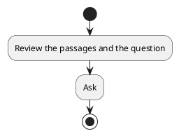
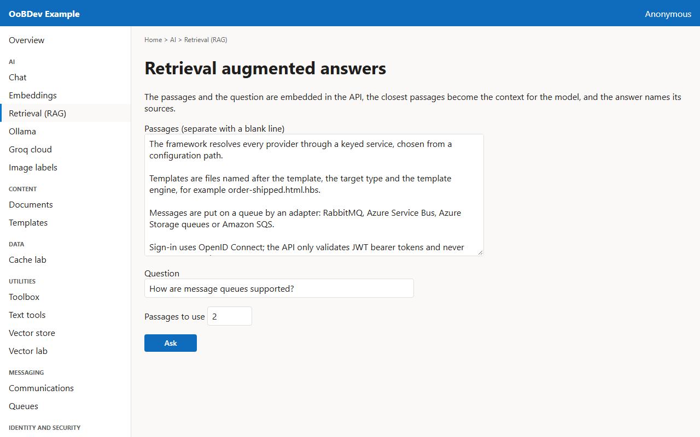
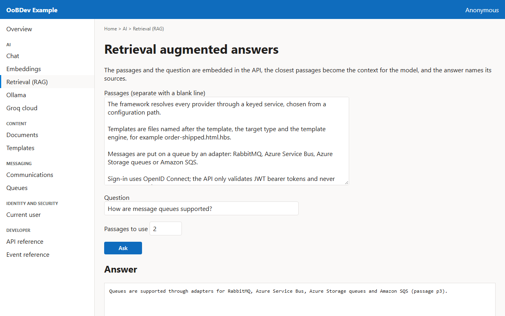

<!-- Generated by the Playwright journeys (src/Examples/OoBDev.Example.Web/e2e). Do not edit by hand: change the journey and rerun `npm run e2e`. This guide is rebuilt on every run. -->

# Ask a question about your own text

[User guides](README.md) | [Spec](../specs/ask-your-own-documents.md) | [Run book](../runbooks/ask-your-own-documents.md)

## Contents

- [Goal](#goal)
- [Why use it](#why-use-it)
- [Before you start](#before-you-start)
- [Journey at a glance](#journey-at-a-glance)
- [Steps](#steps)

## Goal

**Who:** A developer learning retrieval augmented generation.

Give the model a few passages, ask a question, and see which passages the answer came from.

## Why use it

Ground answers in your own text (retrieval augmented generation) so the model answers from your passages instead of guessing.

## Before you start

- The Ollama container is running with the phi3 model.

Related framework features: OoBDev.Onnx.SentenceEmbeddings; OoBDev.Ollama; OoBDev.AI.Abstractions.

## Journey at a glance

*Figure 1 — Ask a question about your own text: the steps in order*

## Steps

### 1. Review the passages and the question

Sample passages are filled in. Separate your own passages with a blank line.

*Figure 2 — Review the passages and the question*

### 2. Ask

The API finds the closest passages by cosine similarity and asks the model to answer from them only.

*Figure 3 — Ask*
