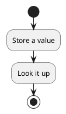
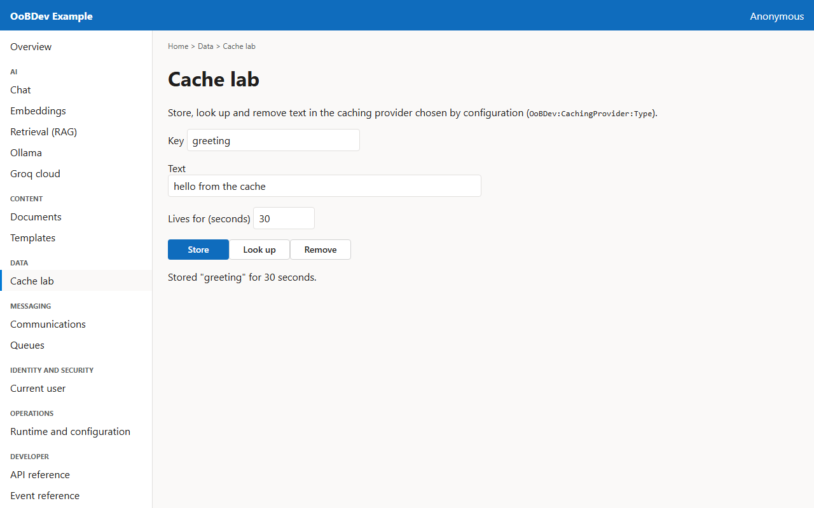
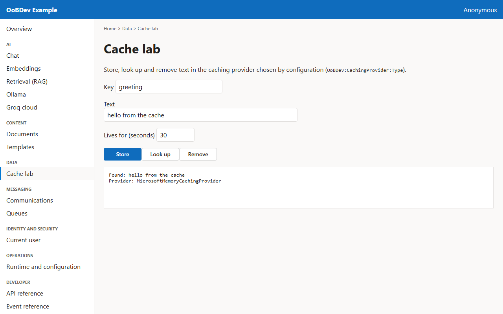

<!-- Generated by the Playwright journeys (src/Examples/OoBDev.Example.Web/e2e). Do not edit by hand: change the journey and rerun `npm run e2e`. This guide is rebuilt on every run. -->

# Cache a value

[User guides](README.md) | [Spec](../specs/cache-a-value.md) | [Run book](../runbooks/cache-a-value.md)

## Contents

- [Goal](#goal)
- [Why use it](#why-use-it)
- [Before you start](#before-you-start)
- [Journey at a glance](#journey-at-a-glance)
- [Steps](#steps)

## Goal

**Who:** A developer adding caching to a service.

Store text under a key, read it back, and remove it.

## Why use it

Keep expensive results close by behind one interface; switch between in-memory and Redis by configuration, not code.

## Before you start

- Nothing beyond a running example stack.

Related framework features: OoBDev.Caching (`ICachingProvider`); OoBDev.Microsoft.Caching; OoBDev.Redis.Caching.

## Journey at a glance

*Figure 1 — Cache a value: the steps in order*

## Steps

### 1. Store a value

Pick a key, some text and how long it should live, then press Store.

*Figure 2 — Store a value*

### 2. Look it up

Look the key up. The result also names the caching provider that answered.

*Figure 3 — Look it up*
