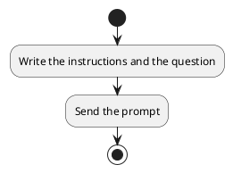
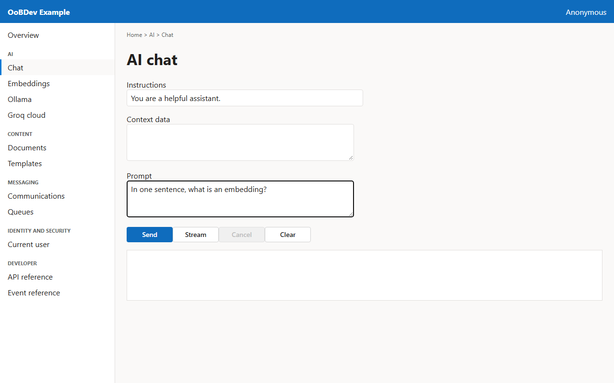
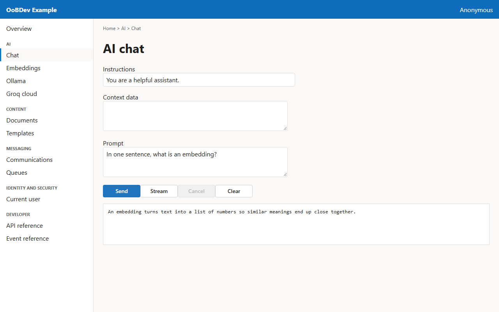

<!-- Generated by the Playwright journeys (src/Examples/OoBDev.Example.Web/e2e). Do not edit by hand: change the journey and rerun `npm run e2e`. This guide is rebuilt on every run. -->

# Chat with a local model

[User guides](README.md) | [Spec](../specs/chat-with-a-local-model.md)

## Contents

- [Goal](#goal)
- [Before you start](#before-you-start)
- [Journey at a glance](#journey-at-a-glance)
- [Steps](#steps)

## Goal

**Who:** A developer trying the AI abstractions without a cloud account.

Ask a question and read the answer from a model that runs in the Ollama container.

## Before you start

- The Ollama container is running with the phi3 model.

Related framework features: OoBDev.AI.Abstractions (`IMessageCompletion`, `IStreamedCompletion`); OoBDev.Ollama.

## Journey at a glance

*Figure 1 — Chat with a local model: the steps in order*

## Steps

### 1. Write the instructions and the question

The instructions tell the model how to behave; the prompt is the question itself.

*Figure 2 — Write the instructions and the question*

### 2. Send the prompt

Send waits for the whole answer. Stream shows the answer as the model produces it.

*Figure 3 — Send the prompt*
