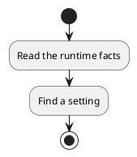
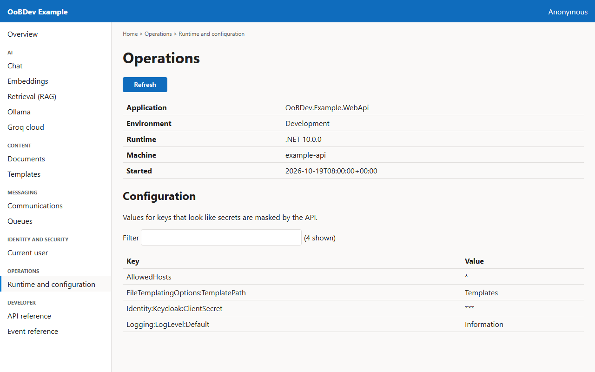
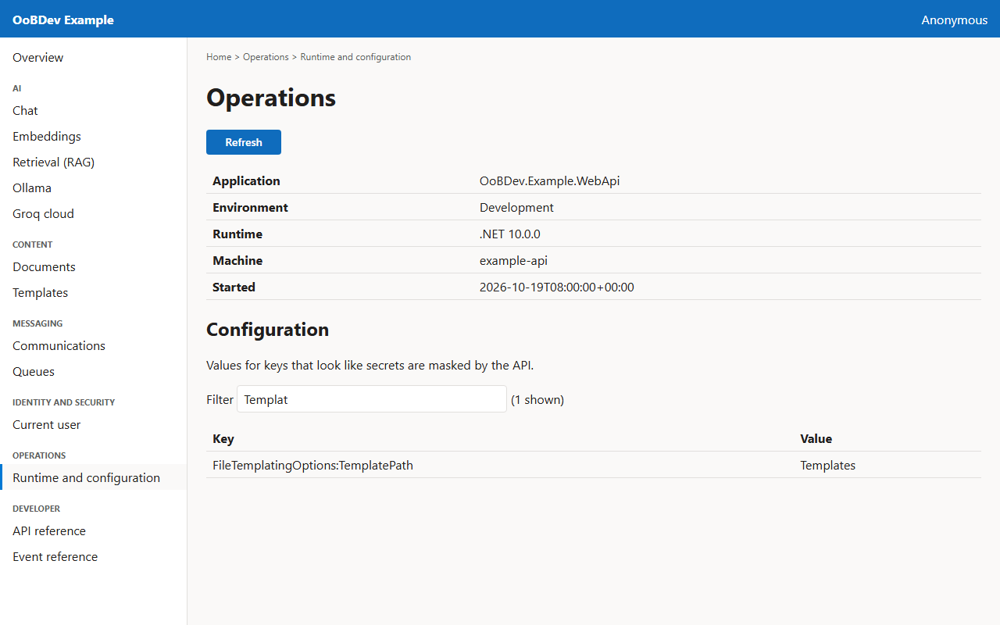

<!-- Generated by the Playwright journeys (src/Examples/OoBDev.Example.Web/e2e). Do not edit by hand: change the journey and rerun `npm run e2e`. This guide is rebuilt on every run. -->

# Check the running service

[User guides](README.md) | [Spec](../specs/check-the-running-service.md)

## Contents

- [Goal](#goal)
- [Before you start](#before-you-start)
- [Journey at a glance](#journey-at-a-glance)
- [Steps](#steps)

## Goal

**Who:** An operator.

See which environment the API runs in and find a configuration setting.

## Before you start

- Nothing beyond a running example stack.

Related framework features: OoBDev.AspNetCore.Mvc; Microsoft.Extensions.Configuration.

## Journey at a glance

*Figure 1 — Check the running service: the steps in order*

## Steps

### 1. Read the runtime facts

The page loads the environment, runtime and machine the API runs on.

*Figure 2 — Read the runtime facts*

### 2. Find a setting

Type part of a key to narrow the configuration list. Secret values are masked by the API.

*Figure 3 — Find a setting*
