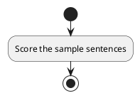
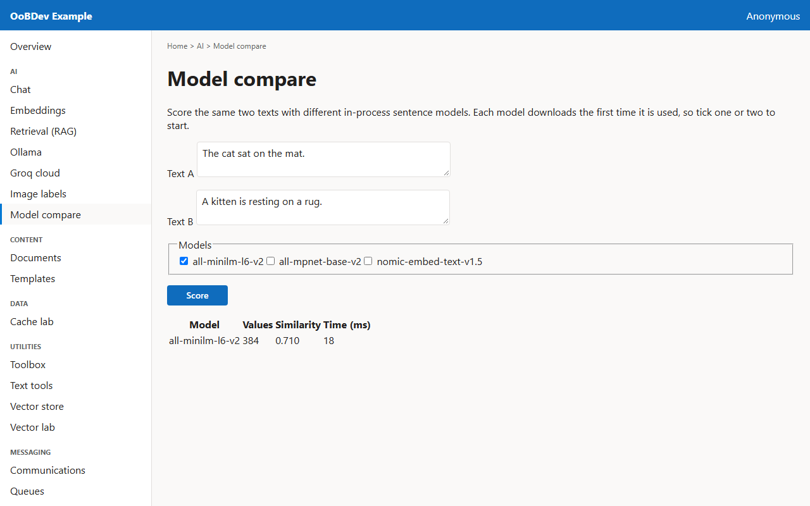

<!-- Generated by the Playwright journeys (src/Examples/OoBDev.Example.Web/e2e). Do not edit by hand: change the journey and rerun `npm run e2e`. This guide is rebuilt on every run. -->

# Compare sentence embedding models

[User guides](README.md) | [Spec](../specs/compare-embedding-models.md) | [Run book](../runbooks/compare-embedding-models.md)

## Contents

- [Goal](#goal)
- [Why use it](#why-use-it)
- [Before you start](#before-you-start)
- [Journey at a glance](#journey-at-a-glance)
- [Steps](#steps)

## Goal

**Who:** A developer choosing an embedding model.

Score the same pair of sentences with a chosen model and see its vector size and speed.

## Why use it

Models are registered side by side under keys, so switching or comparing models is a change of key, not of code.

## Before you start

- Each model downloads once into the shared hub cache, so the first use of a model needs internet.

Related framework features: OoBDev.SBert.AllMiniLmL6V2; OoBDev.SBert.AllMpnetBaseV2; OoBDev.SBert.NomicEmbedTextV1_5; OoBDev.Onnx.SentenceEmbeddings.

## Journey at a glance

*Figure 1 — Compare sentence embedding models: the steps in order*

## Steps

### 1. Score the sample sentences

Two similar sentences are filled in with the first model ticked. Score them.

*Figure 2 — Score the sample sentences*
