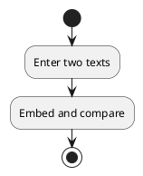
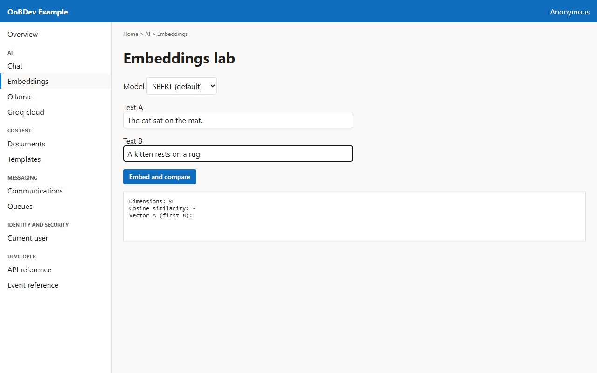
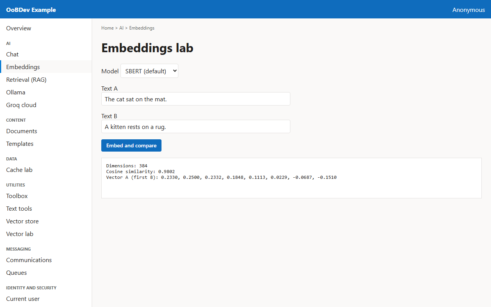

<!-- Generated by the Playwright journeys (src/Examples/OoBDev.Example.Web/e2e). Do not edit by hand: change the journey and rerun `npm run e2e`. This guide is rebuilt on every run. -->

# Compare two texts with embeddings

[User guides](README.md) | [Spec](../specs/compare-two-texts.md) | [Run book](../runbooks/compare-two-texts.md)

## Contents

- [Goal](#goal)
- [Why use it](#why-use-it)
- [Before you start](#before-you-start)
- [Journey at a glance](#journey-at-a-glance)
- [Steps](#steps)

## Goal

**Who:** A developer learning how semantic similarity works.

Turn two sentences into vectors and read how close they are.

## Why use it

Turn text into vectors and measure similarity in process, the basis of semantic search, deduplication and clustering without a remote service.

## Before you start

- The all-MiniLM embedder is available in the API.

Related framework features: OoBDev.Onnx.SentenceEmbeddings; OoBDev.AI.Abstractions (`IEmbeddingProvider`).

## Journey at a glance

*Figure 1 — Compare two texts with embeddings: the steps in order*

## Steps

### 1. Enter two texts

Choose the model and type the two sentences to compare.

*Figure 2 — Enter two texts*

### 2. Embed and compare

The screen shows the vector size, the cosine similarity (1 means identical meaning) and the first values of the vector.

*Figure 3 — Embed and compare*
