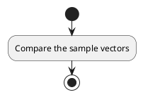
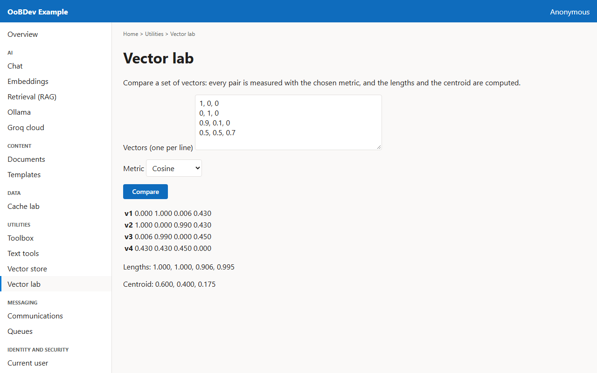

<!-- Generated by the Playwright journeys (src/Examples/OoBDev.Example.Web/e2e). Do not edit by hand: change the journey and rerun `npm run e2e`. This guide is rebuilt on every run. -->

# Compare a set of vectors

[User guides](README.md) | [Spec](../specs/compare-vectors.md) | [Run book](../runbooks/compare-vectors.md)

## Contents

- [Goal](#goal)
- [Why use it](#why-use-it)
- [Before you start](#before-you-start)
- [Journey at a glance](#journey-at-a-glance)
- [Steps](#steps)

## Goal

**Who:** A data scientist checking how close embeddings are.

Measure every pair in a small set of vectors and see their lengths and centroid.

## Why use it

One vector type and four metrics give a quick check of whether embeddings group the way you expect before they go into a store.

## Before you start

- Nothing beyond a running example stack.

Related framework features: OoBDev.System.Abstractions (`Vector`, `VectorMath`, `VectorDistanceMetrics`).

## Journey at a glance

*Figure 1 — Compare a set of vectors: the steps in order*

## Steps

### 1. Compare the sample vectors

Four three-value vectors are filled in. Compare them with the cosine metric.

*Figure 2 — Compare the sample vectors*
