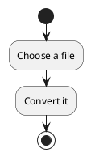
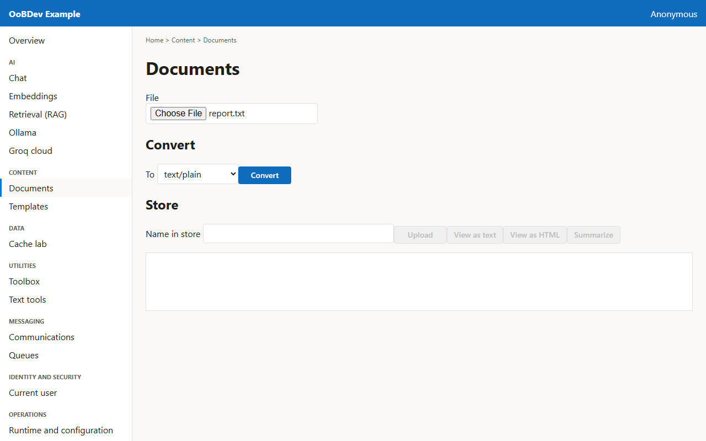
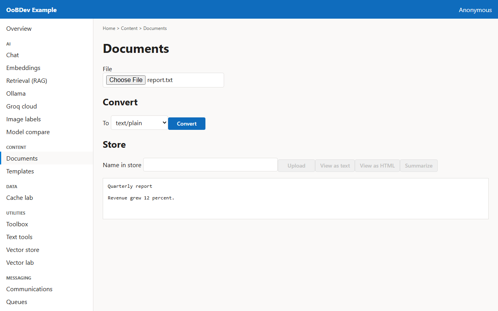

<!-- Generated by the Playwright journeys (src/Examples/OoBDev.Example.Web/e2e). Do not edit by hand: change the journey and rerun `npm run e2e`. This guide is rebuilt on every run. -->

# Convert and store a document

[User guides](README.md) | [Spec](../specs/convert-a-document.md) | [Run book](../runbooks/convert-a-document.md)

## Contents

- [Goal](#goal)
- [Why use it](#why-use-it)
- [Before you start](#before-you-start)
- [Journey at a glance](#journey-at-a-glance)
- [Steps](#steps)

## Goal

**Who:** A developer handling uploaded files.

Upload a file, convert it to plain text and keep it in the document store.

## Why use it

Convert and store documents (text, HTML, PDF, markdown) behind one service, so callers never depend on a converter library.

## Before you start

- Nothing beyond a running example stack.

Related framework features: OoBDev.Documents.

## Journey at a glance

*Figure 1 — Convert and store a document: the steps in order*

## Steps

### 1. Choose a file

Pick the file to work with; every action below uses it.

*Figure 2 — Choose a file*

### 2. Convert it

Choose the target type and convert. The converted text appears below.

*Figure 3 — Convert it*
