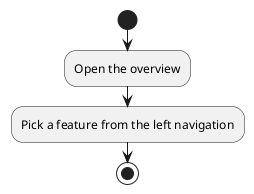
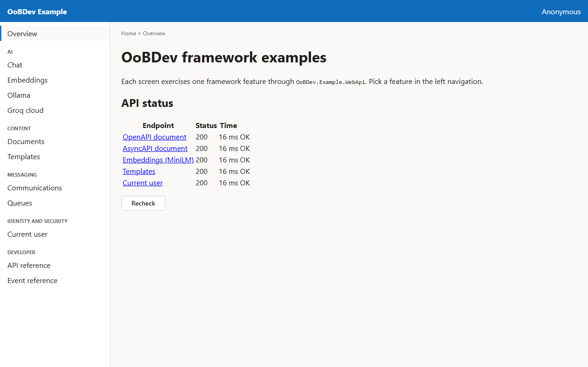
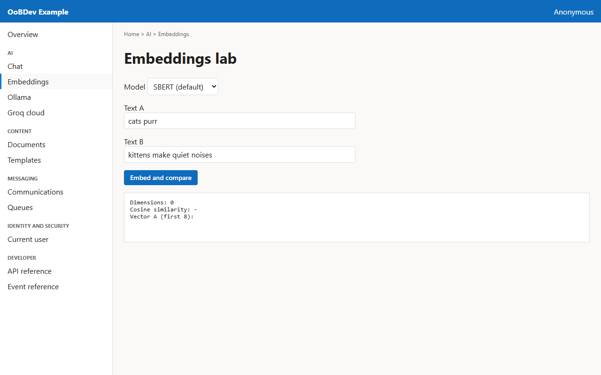

<!-- Generated by the Playwright journeys (src/Examples/OoBDev.Example.Web/e2e). Do not edit by hand: change the journey and rerun `npm run e2e`. This guide is rebuilt on every run. -->

# Explore the examples

[User guides](README.md) | [Spec](../specs/explore-the-examples.md)

## Contents

- [Goal](#goal)
- [Before you start](#before-you-start)
- [Journey at a glance](#journey-at-a-glance)
- [Steps](#steps)

## Goal

**Who:** A developer evaluating the OoBDev framework.

See which framework features have a working example and confirm the API behind them is healthy.

## Before you start

- The example stack is running (see the deployment guide).

Related framework features: OoBDev.Example.WebApi; OoBDev.AspNetCore.Mvc (OpenAPI and AsyncAPI documents).

## Journey at a glance

*Figure 1 — Explore the examples: the steps in order*

## Steps

### 1. Open the overview

The overview lists every example endpoint and checks that each one answers.

*Figure 2 — Open the overview*

### 2. Pick a feature from the left navigation

The navigation groups the examples by area. Choosing an entry opens its screen in the main blade and updates the breadcrumb.

*Figure 3 — Pick a feature from the left navigation*
