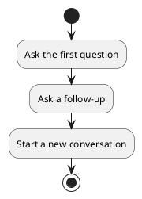
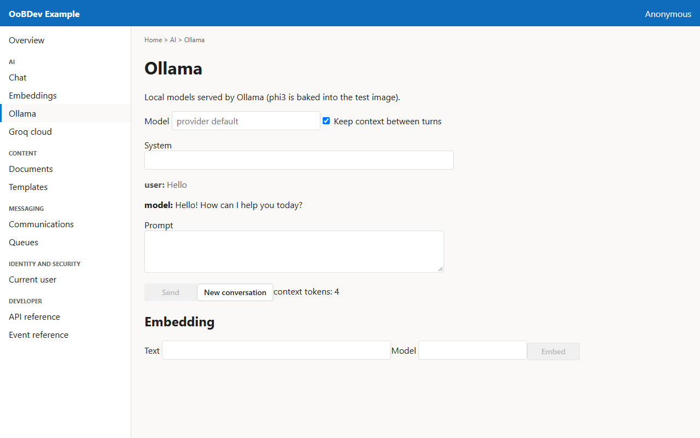
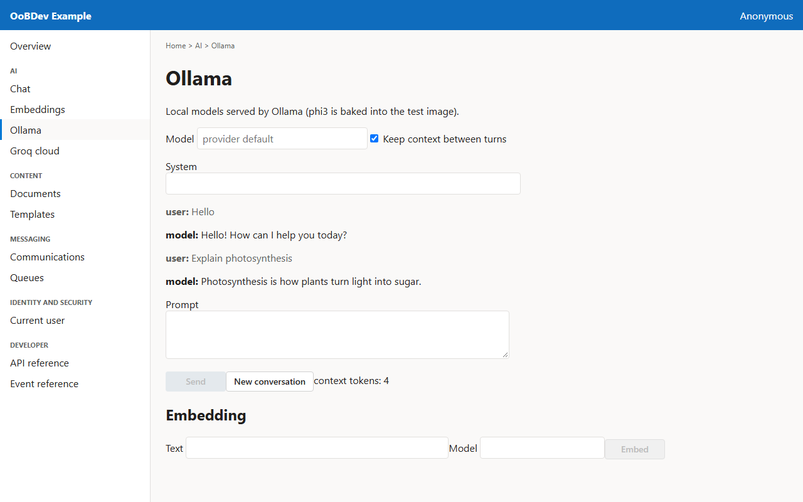
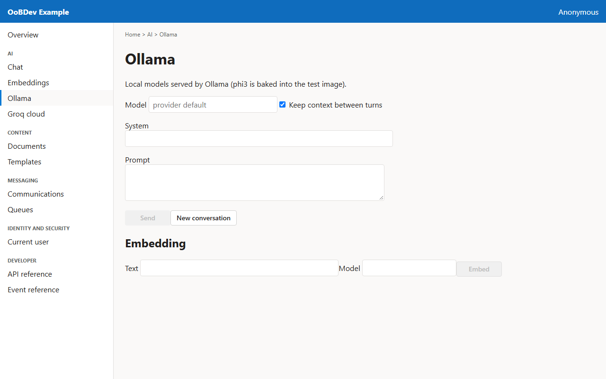

<!-- Generated by the Playwright journeys (src/Examples/OoBDev.Example.Web/e2e). Do not edit by hand: change the journey and rerun `npm run e2e`. This guide is rebuilt on every run. -->

# Hold a conversation with Ollama

[User guides](README.md) | [Spec](../specs/hold-a-conversation.md)

## Contents

- [Goal](#goal)
- [Before you start](#before-you-start)
- [Journey at a glance](#journey-at-a-glance)
- [Steps](#steps)

## Goal

**Who:** A developer checking that the model remembers earlier turns.

Ask two questions in a row and see the conversation context carried between them.

## Before you start

- The Ollama container is running.

Related framework features: OoBDev.AI.Abstractions (`CompletionRequest.Context`); OoBDev.Ollama.

## Journey at a glance

*Figure 1 — Hold a conversation with Ollama: the steps in order*

## Steps

### 1. Ask the first question

Keep context between turns is on by default, so the model returns a context that the next request sends back.

*Figure 2 — Ask the first question*

### 2. Ask a follow-up

The second request carries the context from the first, and the counter shows how much context is held.

*Figure 3 — Ask a follow-up*

### 3. Start a new conversation

New conversation clears the turns and the stored context.

*Figure 4 — Start a new conversation*
