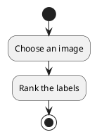
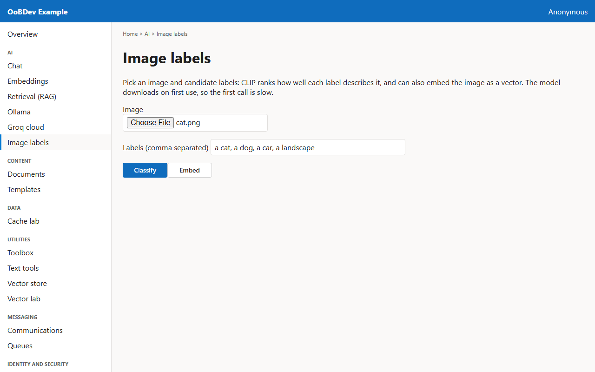
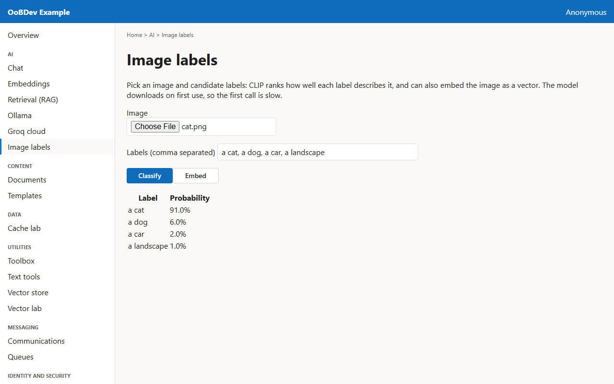

<!-- Generated by the Playwright journeys (src/Examples/OoBDev.Example.Web/e2e). Do not edit by hand: change the journey and rerun `npm run e2e`. This guide is rebuilt on every run. -->

# Label an image without training

[User guides](README.md) | [Spec](../specs/label-an-image.md) | [Run book](../runbooks/label-an-image.md)

## Contents

- [Goal](#goal)
- [Why use it](#why-use-it)
- [Before you start](#before-you-start)
- [Journey at a glance](#journey-at-a-glance)
- [Steps](#steps)

## Goal

**Who:** A developer adding image understanding.

Rank free-text labels against a picture and see its embedding.

## Why use it

CLIP scores any label you type against an image, so new categories need no retraining, and the same model gives a vector for image search.

## Before you start

- The first call downloads the CLIP model into the shared hub cache, so it needs internet once.

Related framework features: OoBDev.Vision.ClipVitB32 (zero-shot classifier); OoBDev.Onnx.ImageEmbeddings; OoBDev.Onnx.ImageEmbeddings.Skia.

## Journey at a glance

*Figure 1 — Label an image without training: the steps in order*

## Steps

### 1. Choose an image

Pick a picture; the default labels are already filled in.

*Figure 2 — Choose an image*

### 2. Rank the labels

Classify the image against the labels.

*Figure 3 — Rank the labels*
