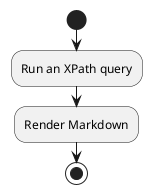
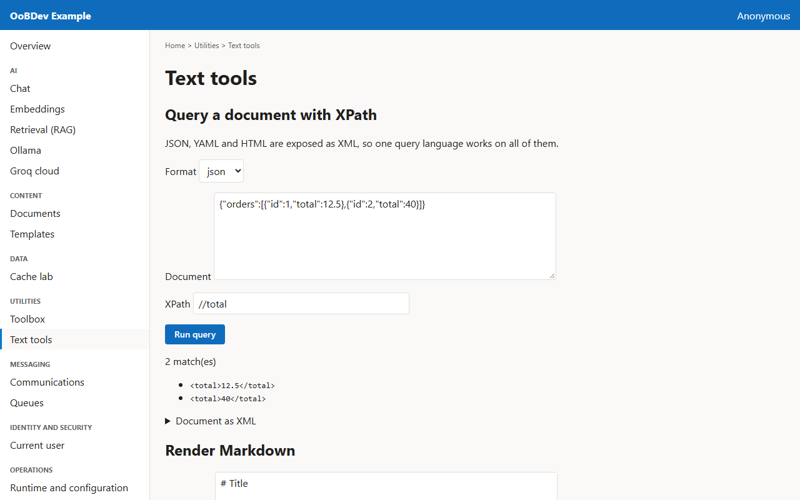
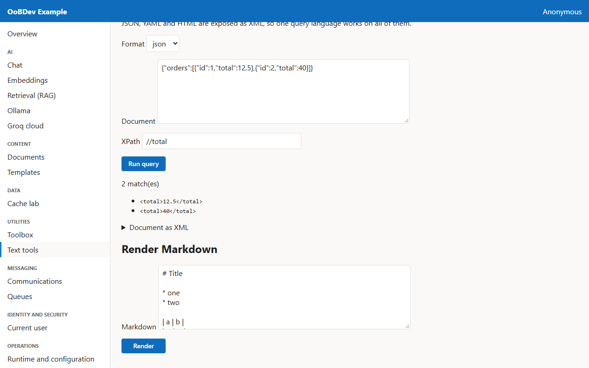

<!-- Generated by the Playwright journeys (src/Examples/OoBDev.Example.Web/e2e). Do not edit by hand: change the journey and rerun `npm run e2e`. This guide is rebuilt on every run. -->

# Query a document and render Markdown

[User guides](README.md) | [Spec](../specs/query-and-render-text.md) | [Run book](../runbooks/query-and-render-text.md)

## Contents

- [Goal](#goal)
- [Why use it](#why-use-it)
- [Before you start](#before-you-start)
- [Journey at a glance](#journey-at-a-glance)
- [Steps](#steps)

## Goal

**Who:** A developer pulling values out of mixed documents.

Query a JSON document with XPath, see the XML view XPath works on, and render Markdown.

## Why use it

One query language, XPath, reads JSON, YAML, HTML and XML, so extraction code does not change when the format does.

## Before you start

- Nothing beyond a running example stack.

Related framework features: OoBDev.System (`JsonNavigator`); OoBDev.System.Text.Yaml (`YamlNavigator`); OoBDev.System.Text.Html (`HtmlNavigator`); OoBDev.System.Text.Markdown (Markdig).

## Journey at a glance

*Figure 1 — Query a document and render Markdown: the steps in order*

## Steps

### 1. Run an XPath query

The sample JSON document and query are filled in. Run the query to list every match.

*Figure 2 — Run an XPath query*

### 2. Render Markdown

Render the sample Markdown to HTML; scripts and event handlers are stripped before it is shown.

*Figure 3 — Render Markdown*
