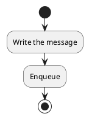
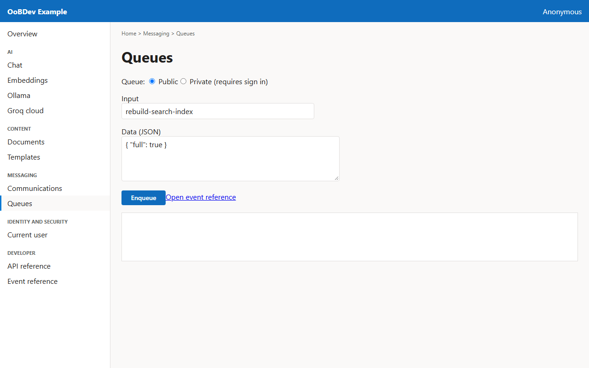
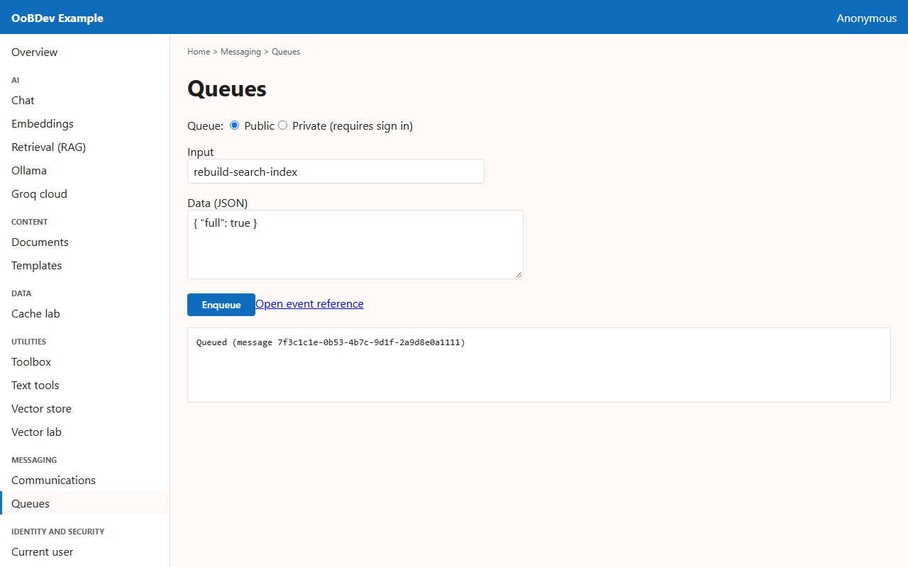

<!-- Generated by the Playwright journeys (src/Examples/OoBDev.Example.Web/e2e). Do not edit by hand: change the journey and rerun `npm run e2e`. This guide is rebuilt on every run. -->

# Put a message on a queue

[User guides](README.md) | [Spec](../specs/queue-a-message.md) | [Run book](../runbooks/queue-a-message.md)

## Contents

- [Goal](#goal)
- [Why use it](#why-use-it)
- [Before you start](#before-you-start)
- [Journey at a glance](#journey-at-a-glance)
- [Steps](#steps)

## Goal

**Who:** A developer testing asynchronous processing.

Enqueue a message and find the event reference that describes the queue.

## Why use it

Hand work to a queue through one interface so RabbitMQ, Service Bus, Storage queues or SQS can be swapped by configuration.

## Before you start

- RabbitMQ (or another queue adapter) is running.

Related framework features: OoBDev.MessageQueue; OoBDev.AsyncApi.

## Journey at a glance

*Figure 1 — Put a message on a queue: the steps in order*

## Steps

### 1. Write the message

Give the message input text and optional JSON data.

*Figure 2 — Write the message*

### 2. Enqueue

The API confirms the message was queued. The link beside the button opens the generated AsyncAPI event reference.

*Figure 3 — Enqueue*
