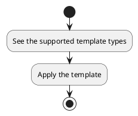
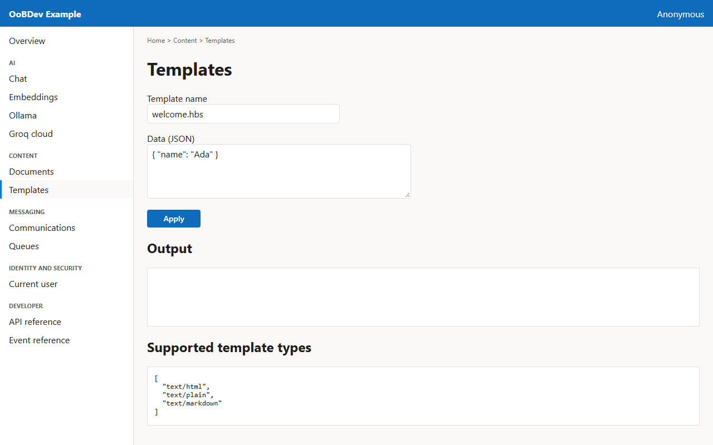
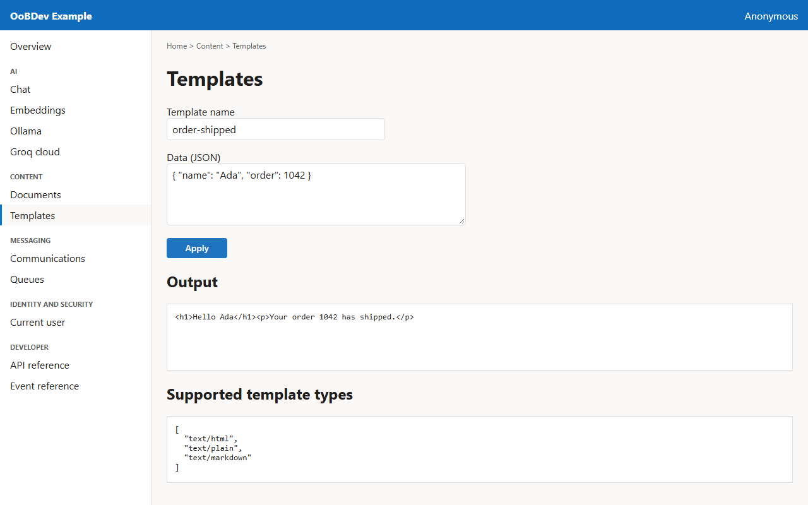

<!-- Generated by the Playwright journeys (src/Examples/OoBDev.Example.Web/e2e). Do not edit by hand: change the journey and rerun `npm run e2e`. This guide is rebuilt on every run. -->

# Render a text template

[User guides](README.md) | [Spec](../specs/render-a-template.md)

## Contents

- [Goal](#goal)
- [Before you start](#before-you-start)
- [Journey at a glance](#journey-at-a-glance)
- [Steps](#steps)

## Goal

**Who:** A developer producing documents or email bodies from data.

Fill a template with JSON data and read the result.

## Before you start

- Nothing beyond a running example stack.

Related framework features: OoBDev.Text.Templating.

## Journey at a glance

*Figure 1 — Render a text template: the steps in order*

## Steps

### 1. See the supported template types

On load the screen asks the API which template formats it supports.

*Figure 2 — See the supported template types*

### 2. Apply the template

Give the template name and its data, then apply it.

*Figure 3 — Apply the template*
