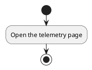
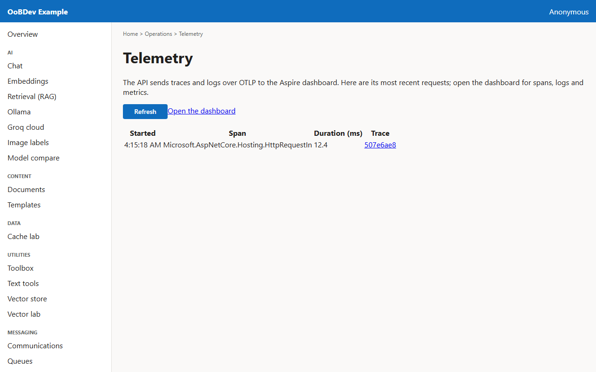

<!-- Generated by the Playwright journeys (src/Examples/OoBDev.Example.Web/e2e). Do not edit by hand: change the journey and rerun `npm run e2e`. This guide is rebuilt on every run. -->

# See what the API just did

[User guides](README.md) | [Spec](../specs/see-recent-traces.md) | [Run book](../runbooks/see-recent-traces.md)

## Contents

- [Goal](#goal)
- [Why use it](#why-use-it)
- [Before you start](#before-you-start)
- [Journey at a glance](#journey-at-a-glance)
- [Steps](#steps)

## Goal

**Who:** An operator checking a request.

List the latest traces the API sent to the dashboard and jump to one.

## Why use it

Traces and logs leave the service over OTLP, so any dashboard can show them; this page reads the latest back and links into the dashboard for the detail.

## Before you start

- The compose stack is running, which includes the Aspire dashboard.

Related framework features: OoBDev.OpenTelemetry (OTLP export); Aspire dashboard telemetry API.

## Journey at a glance

*Figure 1 — See what the API just did: the steps in order*

## Steps

### 1. Open the telemetry page

The page loads the most recent traces on its own; use Refresh to reload them.

*Figure 2 — Open the telemetry page*
