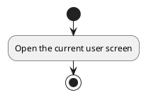
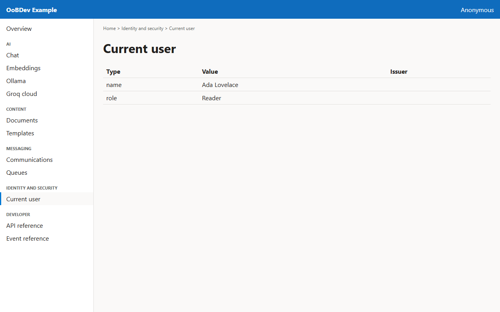

<!-- Generated by the Playwright journeys (src/Examples/OoBDev.Example.Web/e2e). Do not edit by hand: change the journey and rerun `npm run e2e`. This guide is rebuilt on every run. -->

# See the claims on your token

[User guides](README.md) | [Spec](../specs/see-who-you-are.md)

## Contents

- [Goal](#goal)
- [Before you start](#before-you-start)
- [Journey at a glance](#journey-at-a-glance)
- [Steps](#steps)

## Goal

**Who:** A developer checking authentication.

Read the claims the API sees for the current user.

## Before you start

- Sign-in is configured, or the API runs with identity disabled for local work.

Related framework features: OoBDev.Identity; Keycloak (OIDC, JWT bearer).

## Journey at a glance

*Figure 1 — See the claims on your token: the steps in order*

## Steps

### 1. Open the current user screen

The screen calls the API and lists every claim on the access token.

*Figure 2 — Open the current user screen*
