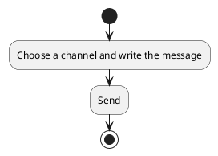
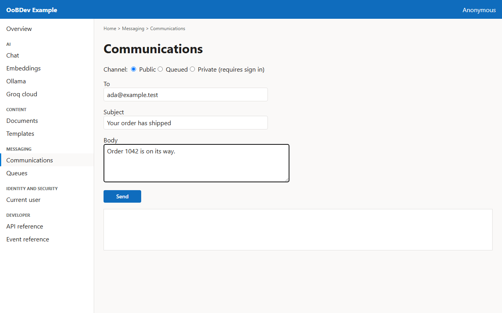
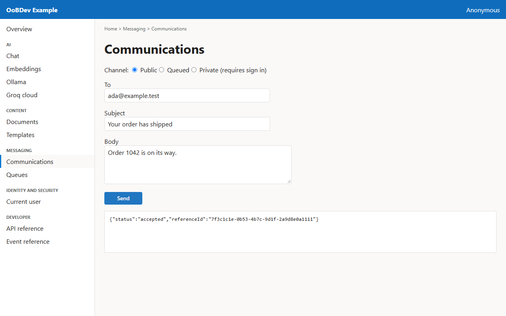

<!-- Generated by the Playwright journeys (src/Examples/OoBDev.Example.Web/e2e). Do not edit by hand: change the journey and rerun `npm run e2e`. This guide is rebuilt on every run. -->

# Send an email through a channel

[User guides](README.md) | [Spec](../specs/send-an-email.md)

## Contents

- [Goal](#goal)
- [Before you start](#before-you-start)
- [Journey at a glance](#journey-at-a-glance)
- [Steps](#steps)

## Goal

**Who:** A developer wiring notifications into an application.

Send a message through the public channel and read the acknowledgement.

## Before you start

- The SMTP4Dev container is running to receive the message.

Related framework features: OoBDev.Communications; OoBDev.MailKit.

## Journey at a glance

*Figure 1 — Send an email through a channel: the steps in order*

## Steps

### 1. Choose a channel and write the message

Public sends straight away, Queued hands the message to the queue, Private needs a signed-in user.

*Figure 2 — Choose a channel and write the message*

### 2. Send

The API acknowledges the message with a reference id.

*Figure 3 — Send*
