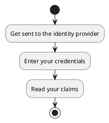
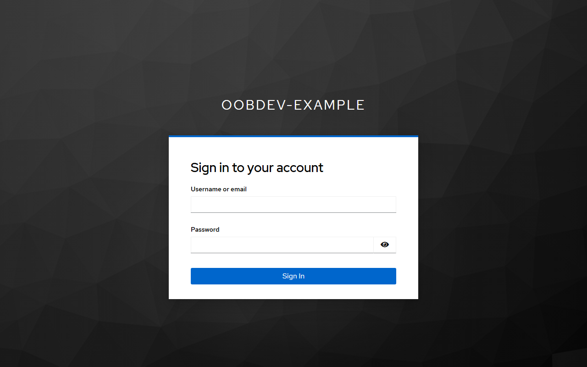
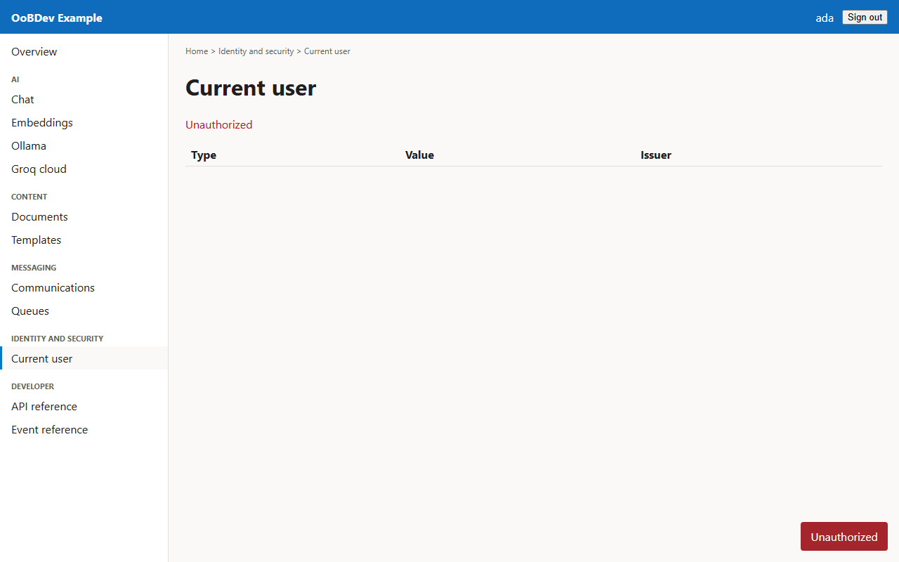

<!-- Generated by the Playwright journeys (src/Examples/OoBDev.Example.Web/e2e). Do not edit by hand: change the journey and rerun `npm run e2e`. This guide is rebuilt on every run. -->

# Sign in with Keycloak

[User guides](README.md) | [Spec](../specs/sign-in.md) | [Run book](../runbooks/sign-in.md)

## Contents

- [Goal](#goal)
- [Why use it](#why-use-it)
- [Before you start](#before-you-start)
- [Journey at a glance](#journey-at-a-glance)
- [Steps](#steps)

## Goal

**Who:** A user opening the example for the first time.

Sign in through the identity provider and land on the screen that was asked for.

## Why use it

Authenticate with OpenID Connect and PKCE so the SPA and API handle only tokens, never passwords.

## Before you start

- The compose stack is running with sign-in on (the default) and the `oobdev-example` realm imported.
- Use the sample user `ada` (password `ada`) or `grace` (password `grace`, also an admin).

Related framework features: OoBDev.Identity; OoBDev.AspNetCore.JwtAuthentication; Keycloak (authorization code with PKCE).

## Journey at a glance

*Figure 1 — Sign in with Keycloak: the steps in order*

## Steps

### 1. Get sent to the identity provider

Every screen needs a token, so the application sends you to Keycloak. The application never sees your password.

*Figure 2 — Get sent to the identity provider*

### 2. Enter your credentials

Type the user name and password of a sample user and sign in.

*Figure 3 — Enter your credentials*

### 3. Read your claims

The current user screen lists the claims the API read from your access token.

*Figure 4 — Read your claims*
