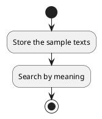
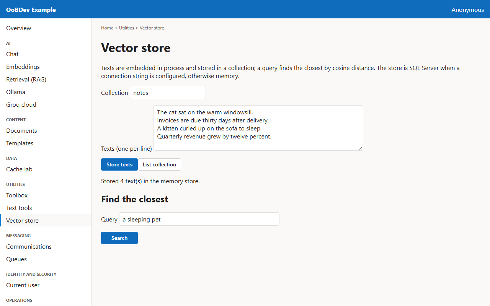
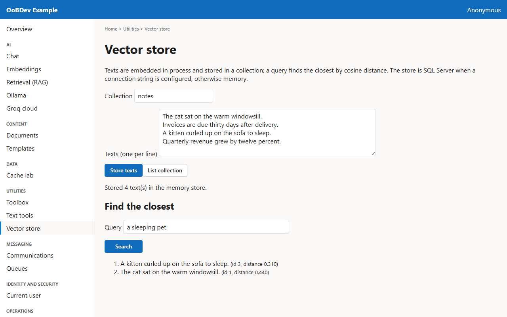

<!-- Generated by the Playwright journeys (src/Examples/OoBDev.Example.Web/e2e). Do not edit by hand: change the journey and rerun `npm run e2e`. This guide is rebuilt on every run. -->

# Store texts and find the closest

[User guides](README.md) | [Spec](../specs/store-and-search-vectors.md) | [Run book](../runbooks/store-and-search-vectors.md)

## Contents

- [Goal](#goal)
- [Why use it](#why-use-it)
- [Before you start](#before-you-start)
- [Journey at a glance](#journey-at-a-glance)
- [Steps](#steps)

## Goal

**Who:** A developer adding semantic search to an application.

Embed a few sentences into a collection and find the ones closest in meaning to a query.

## Why use it

The vector store interface hides where vectors live, so the same code runs on SQL Server, Qdrant or in memory and ranks by meaning instead of keywords.

## Before you start

- Nothing beyond a running example stack.

Related framework features: OoBDev.Search.Abstractions (`IVectorStore`); OoBDev.Data.Vectors.SqlStore (`SqlVectorStoreProvider`); OoBDev.SBert.AllMiniLmL6V2 (embeddings).

## Journey at a glance

*Figure 1 — Store texts and find the closest: the steps in order*

## Steps

### 1. Store the sample texts

Four sentences are filled in, two about pets and two about money. Store them in the notes collection.

*Figure 2 — Store the sample texts*

### 2. Search by meaning

The query a sleeping pet shares no words with the stored sentences but is close to the cat and kitten ones.

*Figure 3 — Search by meaning*
