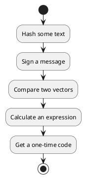
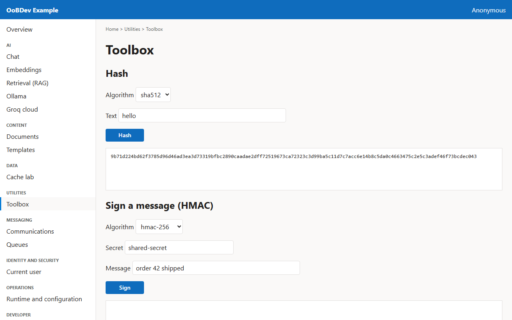
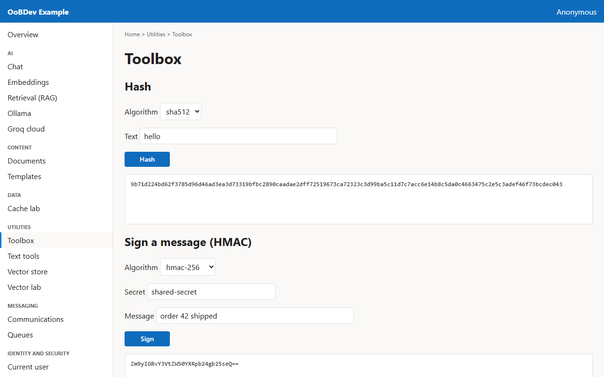
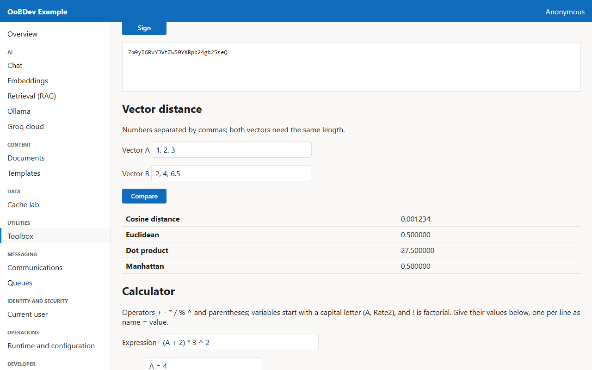
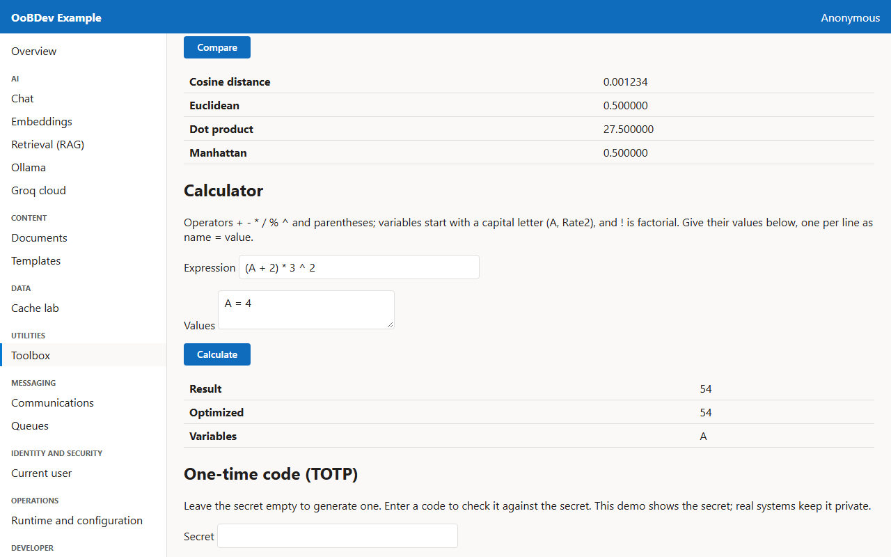
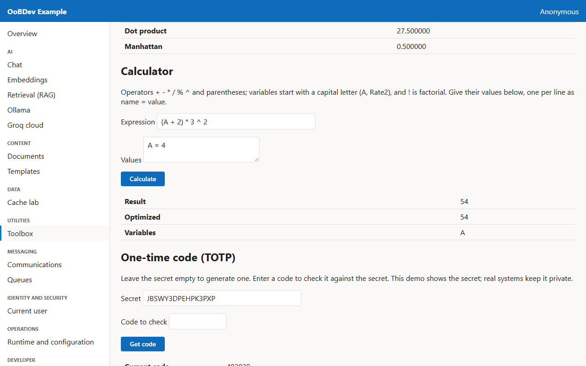

<!-- Generated by the Playwright journeys (src/Examples/OoBDev.Example.Web/e2e). Do not edit by hand: change the journey and rerun `npm run e2e`. This guide is rebuilt on every run. -->

# Hash, sign, compare and calculate

[User guides](README.md) | [Spec](../specs/use-the-toolbox.md) | [Run book](../runbooks/use-the-toolbox.md)

## Contents

- [Goal](#goal)
- [Why use it](#why-use-it)
- [Before you start](#before-you-start)
- [Journey at a glance](#journey-at-a-glance)
- [Steps](#steps)

## Goal

**Who:** A developer checking integrity and similarity.

Hash some text, sign a message with a shared secret, measure how far apart two vectors are, evaluate an expression and get a one-time code.

## Why use it

Pick the algorithm by key from configuration instead of hard-coding it; the default hash is SHA-512, and signing and vector math are one call each.

## Before you start

- Nothing beyond a running example stack.

Related framework features: OoBDev.System (`IHash`, `IHMACCalculator`); OoBDev.System.Abstractions (`VectorMath`).

## Journey at a glance

*Figure 1 — Hash, sign, compare and calculate: the steps in order*

## Steps

### 1. Hash some text

Choose an algorithm and press Hash. The same text always gives the same hash.

*Figure 2 — Hash some text*

### 2. Sign a message

Sign a message with a shared secret; the receiver recomputes the signature to prove the message is unchanged.

*Figure 3 — Sign a message*

### 3. Compare two vectors

Compare two number lists under cosine, Euclidean, dot product and Manhattan distance.

*Figure 4 — Compare two vectors*

### 4. Calculate an expression

Type an expression with a variable, give the variable a value and calculate. The service also shows the optimized form.

*Figure 5 — Calculate an expression*

### 5. Get a one-time code

Leave the secret empty to generate one, then read the current code and the authenticator URI.

*Figure 6 — Get a one-time code*
