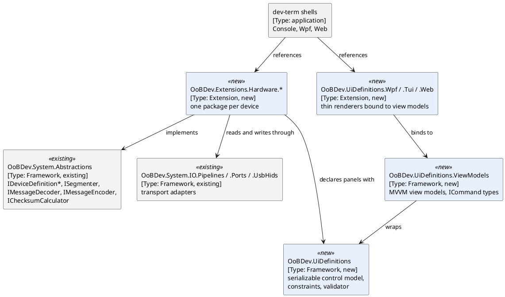

# Device decoding migration plan (dev-term to dotex)

**Written:** 2026-10-26 | **Branch:** `dev/device-decoding` | **Status:** plan, waiting on Q2 and Q3 in [OPEN-QUESTIONS.md](../../OPEN-QUESTIONS.md)

Source: `C:\repo\oobdev\dev-term` (branch `dev/zstick-s2`, commit `d777358`; the Z-Wave module is still changing there). The owner wants the binary protocol decoders in this framework, and dev-term rebuilt on top of them later ([harvest-candidates.md](../harvest-candidates.md)).

## Contents

- [1. Scope](#1-scope)
- [2. Inventory](#2-inventory)
- [3. Target shape](#3-target-shape)
- [4. Conflicts with code already in the repository](#4-conflicts-with-code-already-in-the-repository)
- [5. Conversion rules](#5-conversion-rules)
- [6. Testing: keep the dev-term approach](#6-testing-keep-the-dev-term-approach)
- [7. Order of work](#7-order-of-work)
- [8. Risks and open points](#8-risks-and-open-points)

### List of Figures

1. Figure 1 — Target layering

### List of Tables

1. Table 1 — Device projects in dev-term
2. Table 2 — Pattern conversions
3. Table 3 — Order of work
4. Table 4 — Overlaps with existing code

## 1. Scope

In scope: the protocol layer of every `DevTerm.Devices.*` project (framers, decoders, command builders, value models) and the shared contracts they need. The UI framework is also in scope (owner, 2026-10-26), with the aim of making it reusable here: the toolkit-neutral `DevTerm.UiDefinitions` model first, then a view-model layer and the renderers (section 3). The dev-term application shells (main windows, session management, plugin loading) are converted to use the OoBDev libraries rather than left behind (owner, 2026-10-26). Where dev-term ends up is Q4: either it becomes a tool or tool framework under this project, or it stays its own repository and depends on dotex over NuGet. Both work with the layering in section 3, because the shells only consume the packages. Transports and `DevTerm.DeviceManifests` are phases 8 and 9 and depend on Q3.

Base decision (owner, 2026-10-26): for these protocols the dev-term implementations are better than the BinaryDataDecoders ones, so dev-term is the base for every device. The best-coverage rule still applies in a narrower form: each device is compared once with the BinaryDataDecoders copies (`Incoming/BinaryDecoders`, `C:\repo\mine\binary-data-decoders`) for anything dev-term lacks (message types, sentences, fields), and only those parts are merged; the rest of the older code is rejected with the reason recorded. The device parity note named in `harvest-candidates.md` (`projects/device-parity.md`) was not found under `C:\repo\mine\projects`; phase 0 rebuilds that table.

## 2. Inventory

**Table 1 — Device projects in dev-term**

| Project | Protocol | Source LOC | Unit tests | Notes |
|---------|----------|-----------:|-----------:|-------|
| `Devices.Scpi` | SCPI text, instrument profiles, auto-detect | 994 | 103 | Profiles are data; reply tracking is stateful |
| `Devices.ZWave` | Z-Wave serial API frames, ACK responder, id tables | 1,688 | 64 | Active work upstream; `Data/*.json` tables |
| `Devices.RadexOne` | Word-sum checksummed packets over virtual COM | 772 | 36 | Verified on hardware |
| `Devices.Nmea` | NMEA 0183 sentences, GPS state | 486 | 29 | Overlaps `Incoming/BinaryDecoders/src/OoBDev.Nmea` |
| `Devices.ZoomH4n` | Remote-control status byte and button commands | 418 | 16 | Bit fields |
| `Devices.De5000` | 17-byte LCR meter packet, stream only | 417 | 23 | Verified on hardware |
| `Devices.K8055` | HID input and output reports | 374 | 32 | Overlaps `UsbHids` |
| `Devices.Busylight` | 9-byte command report, ASCII id | 369 | 22 | Overlaps `Incoming/BinaryDecoders/src/OoBDev.Kuando.Busylight` |
| `UiDefinitions` | Serializable control model (toggle, slider, choice, numeric, chart, form), constraints, validator, JSON/XML | 3,036 | in `UiDefinitions.Tests` | Toolkit-neutral; the reuse core |
| `Wpf` | WPF renderer (`FormRenderer`, live elements, theming) plus the app windows | 7,354 | in `Wpf.Tests` | Code-behind, not MVVM; 16 XAML files |
| `Console` | Terminal.Gui TUI renderer (`FormRenderer`, cell charts) plus modes | 9,678 | in `Console.Tests` | Depends on `Terminal.Gui` 2.5 |
| `Web` | Loopback web host, Blazor pages, panel API, AsyncAPI | 2,465 | in `Web.Tests` | Overlaps `OoBDev.AsyncApi` and the OpenAPI/Scalar setup |
| `Presenters.Text` | ASCII, UTF-8, hex, decimal, octal, binary presenters | 290 | in `Presenters.Text.Tests` | Phase 1 with the contracts |
| `Devices.Demo` | Sample only | 100 | 0 | Not migrated |
| `DeviceManifests` | JSON/XML manifests, `.ksy` import, frame decoder | 5,825 | in `DeviceManifests.Tests` | Phase 6 |
| `Core` (presenters, control, transports) | Contracts the devices use | 5,892 | in `Core.Tests` | Only the parts devices need |

Each device also has a `.ksy` description and a `known-configuration.md` under dev-term `docs/devices/`; these move with the device.

## 3. Target shape

Pure protocol libraries, one per device (the UI layers are described after Figure 1), built on the device model that already exists in `OoBDev.System.Abstractions` (section 4), packaged separately as `OoBDev.Extensions.Hardware.<Device>` (decision sheet line 19: mark what is untested on hardware in each readme). They reference only the abstractions, never UI or plugin loading.

*Figure 1 — Target layering*

UI reuse. `UiDefinition` already lets a device describe its controls once as data, and each front end renders that data (`ControlPanelMode` and `ControlPanelWindow` proved it with K8055 and Busylight). Migrating it means: (1) `DevTerm.UiDefinitions` moves nearly as is, converted per section 5; (2) a view-model layer is added, because dev-term's renderers are code-behind and this repository requires MVVM with command binding and real, retestable `ICommand` types with injected dependencies (`owner-decisions`); (3) the WPF, Terminal.Gui and Blazor renderers become thin binders over those view models, packaged separately so a consumer takes only the toolkit it uses. The shared logic duplicated today in the two `FormRenderer` classes (validation, command preview, section layout) moves into the view models once. Terminal.Gui is a third-party UI dependency and needs an owner decision (Q3).

Contract mapping (to be settled in the api-design document, phase 1). dev-term's `IPresenter.Render(ReadOnlySequence<byte>) : IReadOnlyList<string>` mixes framing, decoding and text rendering. This repository already separates them, so no new framer or decoder contracts are added: framing is an `ISegmenter` built from an `ISegmentBuildDefinition`, decoding is `IMessageDecoder<TMessage>`, encoding is `IMessageEncoder<TMessage>`, a device is an `IDeviceDefinitionReceiver<TMessage>` and `IDeviceDefinitionTransmitter<TMessage>`, and checksums go through `IChecksumCalculator`. Each device supplies a typed message record; the text rendering dev-term shows is derived from that record by a separate renderer, and `IStructuredPresenter.ValuesChanged` becomes the typed message stream. `IControlSurface.InvokeAsync(string commandId, string? value)` stays a string-keyed surface for panels, backed by typed command encoders that tests call directly. Gaps the existing model may not cover (stateful reply tracking for SCPI, resynchronising on a prefix pair, ACK responders for Z-Wave) are listed in section 4 and become additions to it, not a parallel model.

## 4. Conflicts with code already in the repository

Checked 2026-10-26 against `src/` (nothing in `Incoming/` has been brought in yet).

**Table 4 — Overlaps with existing code**

| Existing | Where | Overlap | Resolution |
|----------|-------|---------|------------|
| `IDevice`, `IDeviceDefinition*`, `IDeviceFactory`, `IDeviceAdapter` | `OoBDev.System.Abstractions/IO` | The device model dev-term's device projects would otherwise reinvent | Build on it; no `IDeviceFramer` or `IDeviceDecoder` |
| `ISegmenter`, `StartAndFixLengthSegmenter`, `BetweenSegmenter` | `OoBDev.System.Abstractions/IO/Segmenters` | Framing: Radex One, De-5000, Z-Wave and NMEA framers | Express each framer as a segmenter; add a prefix-resynchronising segmenter if none fits; compare in phase 0 |
| `IMessageDecoder<T>`, `IMessageEncoder<T>` | `.../IO/Messages` | Decoders and command builders | Use them; check that `Encode(ref TMessage)` suits commands with state |
| `IChecksumCalculator.Simple16` | `.../IO/Functions` | Radex One word-sum, NMEA XOR, Z-Wave checksums | Add the missing algorithms here, tested against dev-term's byte-exact traces |
| `SerialPortAttribute`, `Parity`, `StopBits`, `SerialPortFactory`, `UsbHidFactory` | `.../IO/Ports`, `OoBDev.System.IO.Ports`, `.UsbHids` | Serial settings and HID access used by every device | Use them; dev-term's own serial and HID transports are phase 9 comparisons |
| `OoBDev.System.IO.Pipelines` (`PipelineBuilder`, `StreamDevice`) | Framework | Stream-to-message plumbing, replaces dev-term's `StreamToPipePump` | Use it |
| `Incoming/BinaryDecoders`: Busylight, NMEA, K8055, Radex One, Zoom H4n | Not in `src/` | Older copies of five dev-term devices | dev-term is the base (owner); phase 0 lists what, if anything, to merge from them and records the rejections |

No name clash was found for `OoBDev.Devices`, `OoBDev.Extensions.Hardware.*`, `OoBDev.UiDefinitions`, `UiDefinition`, `ValueConstraint`, `ValueValidator`, `IControlSurface` or `IPresenter`, and `src/` has no UI project to conflict with the renderers. DE-5000, SCPI and Z-Wave have no counterpart anywhere in this repository.

## 5. Conversion rules

The migrated code follows this repository's patterns and practices, not dev-term's (owner, 2026-10-26), except for testing (section 6).

**Table 2 — Pattern conversions**

| dev-term | dotex |
|----------|-------|
| `IPluginModule` registers services | `ServiceCollectionExtensions` with `TryAdd*`; provider selection by `TryAddConfiguredKeyedService<T>` with kebab-case keys in a `{Device}Globals` class |
| `ImplicitUsings` enabled | disabled, explicit `using` |
| Code-behind in `MainWindow.*.cs` and `FormRenderer` | MVVM: view models with `ICommand` classes (injected dependencies, no lambdas), views only bind |
| Several types per file (`RadexOneCommand` and `RadexOneFramer`) | one top-level type per file |
| Options read ad hoc | typed options class per section, `AddValidatedOptions<T>()` |
| `DateTime.UtcNow`, `Task.Delay` pacing | `TimeProvider` |
| `ILogger` calls with templates | `[LoggerMessage]` |
| Long history comments (corrections, dates) in XML docs | XML docs state behaviour; history goes to the device `known-configuration.md` and `docs/changes/` |
| `plugin.json`, `EnableDynamicLoading` | removed from the libraries; plugin loading belongs to the shell (phase 10) |
| Package versions inline in csproj | `src/Directory.Packages.props` |
| No project readme | `README.{Project}.md` per project |
| `InternalsVisibleTo` via `AssemblyInfo.cs` | `InternalsVisibleTo` item in the csproj |

Analyzer warnings (Meziantou, NetAnalyzers, OOB rules) apply to the new projects from the start. The framework is unreleased, so names change outright with no forwarders. Rejected-dependency rules apply (no third-party DI or logging, no Polly).

## 6. Testing: keep the dev-term approach

Tests do not convert to this repository's testing patterns. dev-term's are better documented and generate specs, runbooks and user guides from automated tests. Carry over, with their documentation:

- UI tests: the headless `ScreenshotTests` for TUI and WPF that produce the user-guide screenshots, and the `StaTestRunner` and `TuiTestRunner` harnesses.
- Test categories and the rule that each test carries one, enforced by `DevTerm.CodingStandards.Tests`.
- `RealHardware*Tests`: target read from `.runsettings` run parameters, `Assert.Inconclusive` when the device is absent, so the default run never depends on hardware.
- `LoopbackTransport` with scripted rules for request/response tests without a device, and `FakeTransport` for hand-driven cases.
- Recorded samples and `SampleDataGenerator` for decoder tests; `.ksy` files checked by `DeviceKsyFilesTests`.
- The documentation outputs: `docs/specs`, `docs/user-guide` (captured transcripts and screenshots from tests) and the bench reports in `docs/test`. See dev-term `docs/design/testing.md` and `docs/specs/README.md`.

Where this meets the dotex test rules (`.claude/rules/testing.md`: `Unit`, `Simulate`, `Integration`, `DevLocal`, `LiveIntegration`, Docker for anything outside the process), the category mapping and where the shared test utilities live is Q2. Until it is answered, new device tests use the dev-term category names and helpers, copied unchanged.

## 7. Order of work

**Table 3 — Order of work**

| Phase | Work | Exit |
|------:|------|------|
| 0 | Compare each device with BinaryDataDecoders and `mine/binary-data-decoders` for missing parts only (dev-term is the base); rebuild the parity table; record merges and rejections in [incoming-harvest-crosscheck.md](incoming-harvest-crosscheck.md) | Parity table in `docs/migration/`, merge list and rejections recorded |
| 1 | Feature docs `docs/design/DeviceDecoding/` (requirements, architecture, api-design, testing-strategy); additions to the existing IO model for the gaps in section 4 (no new device contract project unless they do not fit); test helpers per Q2; first end-to-end device as a template | Contracts reviewed, template device green |
| 2 | Simple fixed-frame devices: DE-5000, Busylight, K8055 | Unit tests ported, `.ksy` and device docs moved |
| 3 | NMEA, Radex One, Zoom H4n | As above; NMEA merged with the incoming copy |
| 4 | SCPI with profiles and auto-detect | Profile data loads through options; 103 tests ported |
| 5 | Z-Wave, after the upstream `dev/zstick-s2` work settles | Id tables kept as data files |
| 6 | `OoBDev.UiDefinitions` model, serializer, validator (ported with the phase 2 devices as their panels need it) | Round-trip and validator tests ported |
| 7 | View-model layer with `ICommand` types; WPF renderer first, then Terminal.Gui and Blazor | One device panel rendered by each, driven by the same view model |
| 8 | Device manifests and `.ksy` frame decoding (5,825 LOC) | Decision on Q3 |
| 9 | Transports that dotex lacks (TCP, USBTMC, VXI-11, RFC 2217, BLE, brokers) | Decision on Q3 |
| 10 | dev-term shells (Console, Wpf, Web) rebuilt on the OoBDev packages; dev-term moves under this project as a tool or tool framework, or consumes the packages over NuGet | Decision on Q4; dev-term builds with no copied framework code |

Each device closes with the `complete-work` skill (change document, index, readme, `TODO.md`, `BACKLOG.md`), one commit series per device.

## 8. Risks and open points

- **Moving source.** dev-term has uncommitted history on `dev/zstick-s2`; record the commit ported from in each change document and re-diff before each phase.
- **Overlap with hardware already in the incoming copy** (Busylight, NMEA, K8055 via HID): dev-term is the base, missing parts are merged, and rejected code is documented.
- **UI rewrite cost.** About 19,500 lines of renderer and window code (Wpf, Console, Web) is code-behind; making it MVVM is a rewrite of the logic, not a move. Phase 7 covers the shared panel renderers; phase 10 converts the application shells to consume them and the other OoBDev libraries (hosting, options, logging, OpenTelemetry, OpenAPI/AsyncAPI for the web host).
- **Contract split.** Separating framing, decoding and rendering changes every presenter; the template device in phase 1 proves it before the rest follow.
- **Hardware verification.** Only dev-term's real-hardware tests prove behaviour on a device; ported copies must keep those tests, and the readmes say what was verified on hardware and what was not.
- **Not run yet.** Nothing has been built or ported on this branch; this document is the only change.
