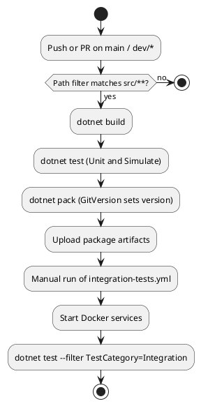

# CI/CD and Versioning

<!-- nav -->
[↑ 03 — Practices and Conventions](./README.md) · [← Logging, Errors and Configuration](./05-logging-errors-and-configuration.md) · [Known Warts (Decide Before Copying) →](./07-known-warts.md)
<!-- nav -->

## Manual CI (`scripts/ci/`)

CI is manual only: nothing runs on push or on a schedule, and the former GitHub workflows are removed (owner, 2026-10-29). `run-tests.ps1` builds and tests by category (starting and stopping the Docker stack for `Integration`); `pack.ps1` packs on demand. Details: [scripts/ci/README.md](../../../scripts/ci/README.md).

## Versioning

`GitVersion.MsBuild` runs in every project (including tests) and derives the version from git history. The configuration file is `GitVersion.yml` at the **repository root** (older docs say `src/`; see [Doc/Code Drift](../README.md)). Major is bumped by hand, minor by every merge into `main` (always a merge commit, never a fast-forward), and a branch previews the next release: after `v0.5.0`, `dev/example-app-fixes` builds `0.6.0-dev-example-app-fixes.1`.

## Packaging

Every packable project (libraries and tools; not tests, examples or AppHost projects) produces a NuGet package with the project readme and license inside, only when `dotnet pack` runs (`scripts/ci/pack.ps1`), never on build. The default output is `G:\nuget`. CI is manual only: there are no scheduled or push builds.

*Figure 2 — pipeline from commit to package*

---

<!-- nav -->
[↑ 03 — Practices and Conventions](./README.md) · [← Logging, Errors and Configuration](./05-logging-errors-and-configuration.md) · [Known Warts (Decide Before Copying) →](./07-known-warts.md)
<!-- nav -->
