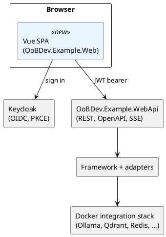

# Future Example Application: Plan and Checklist

**Status:** planning (nothing built yet) · **Created:** 2026-10-19 · **Branch:** `dev/analyzer-burn-down`

Goal: an example front end (Vue, Azure-portal style left navigation) that exercises every framework feature that can sensibly have a UI, backed by the existing `OoBDev.Example.WebApi`.

Related documents:

- [Design specs](docs/design/example-ui/README.md): shell, navigation, conventions
- [Screen designs](docs/design/example-ui/screens.md): per-feature Salt mockups and API bindings

## Table of Contents

- [1. Review scope](#1-review-scope)
- [2. What the example application covers today](#2-what-the-example-application-covers-today)
- [3. What it does not cover](#3-what-it-does-not-cover)
- [4. Front end approach](#4-front-end-approach)
- [5. Work plan and checklist](#5-work-plan-and-checklist)
- [6. Open questions](#6-open-questions)

## List of Figures

- [Figure 1: Example solution context](#4-front-end-approach)

## List of Tables

- Table 1: Covered features (section 2)
- Table 2: Partly covered features (section 2)
- Table 3: Features with no example (section 3)
- Table 4: Phases (section 5)

## 1. Review scope

The request said "full remove of this project"; I read that as a **full review** and changed nothing. Nothing is deleted by this plan.

Repository state when the review was done:

- Working tree clean; all 7 local branches are level with `origin` (`G:/oobdev/dotex.git`), and all 33 tags are on `origin`.
- Not on `origin`: the local-only stash `stash@{0}` ("discarded stale working tree 2026-10-09"). It was deliberately set aside earlier and is not source history.

The review covered 4 layers: 6 Common, about 32 Framework, 7 Extensions and about 35 ExternalServices projects, plus 8 CLI tools, compared with the controllers in `src/Examples/OoBDev.Example.WebApi`.

## 2. What the example application covers today

The example API exposes 11 controllers plus the shared pipeline (`TryAllCommonExtensions`, OpenAPI with Scalar, AsyncAPI viewer, JWT bearer with Keycloak, OpenTelemetry).

**Table 1 — Covered features**

| Feature | Example endpoints | Framework area |
|---|---|---|
| Generative AI chat | `POST api/AI`, `api/AI/Streamed`, `api/AI/Context` | AI.Abstractions, Ollama, GroqCloud |
| Embeddings | `POST api/AI/Embeddings`, `GET api/AllMiniLM`, `GET api/SBERT`, `GET api/SBERTDefault` | SBert, AllMiniLmL6V2 |
| RAG | `POST api/AI/RaggedAnne` | AI, Search |
| Ollama direct | `POST api/Ollama`, `api/Ollama/Streamed`, `api/Ollama/Completion`, `GET api/Ollama` | Ollama |
| Groq direct | `POST api/GroqCloud/Completion` | GroqCloud |
| Communications | `POST api/Communications/public`, `queued`, `private` | Communications, MailKit |
| Message queueing | `POST api/MessageQueueing/public`, `private` | MessageQueueing and queue adapters |
| Documents | `Document/Download`, `Text`, `Html`, `Pdf`, `Summary`, `Upload`, `Convert` | Documents, Tika, MysticMind, WkHtmlToPdf |
| Text templates | `POST api/TextTemplate/SupportedTemplates`, `Apply` | Handlebars and template engines |
| Current user | `GET api/User/claims` | Identity, Keycloak, JwtAuthentication |
| API documentation | Scalar reference, `/openapi/{name}.json` | AspNetCore.Mvc |
| Event documentation | `/asyncapi/{name}.json` and viewer | AsyncApi |

**Table 2 — Partly covered features**

| Feature | What exists | What is missing |
|---|---|---|
| Search | `SearchController` is fully commented out | list, semantic, lexical and hybrid search endpoints |
| Text template management | `Query` and `Save` are commented out | template list, edit and save |
| Caching | wired by the common builder, no endpoint | visible hit and miss, flush |
| Telemetry | exported by OpenTelemetry | no in-app trace or log view |
| Vector stores | Qdrant and OpenSearch adapters are wired for RAG only | collection browsing, upsert, query |
| Mail receive | hosting is disabled (`DisableMailKit = true`) | inbox view |

## 3. What it does not cover

**Table 3 — Features with no example**

| Area | Projects | UI worth building |
|---|---|---|
| Image embeddings and vision | Onnx.ImageEmbeddings (+Skia), Vision.ClipVitB32, Dinov2Small, VitBasePatch16 | yes: upload image, vector, similarity, zero-shot labels |
| Sentence embeddings (ONNX) | Onnx.SentenceEmbeddings, SBert.AllMpnetBaseV2, NomicEmbedTextV1_5 | yes: model picker, compare vectors |
| Vectors in SQL | Data.Vectors, Vectors.DB, Vectors.Hosting | yes: vector and matrix calculator |
| Identity management | Identity, Keycloak user manager | yes: user lookup, rights, sessions |
| Data access | Data.Common, MongoDB, SqlServer.Server, DacFx, DacPack builder | yes: query runner, dacpac build |
| Queue adapters | Amazon.Sqs, Azure.ServiceBus, Azure.StorageAccount, RabbitMQ | yes: provider status, send and receive monitor |
| Blob storage | Azure.StorageAccount, Documents containers | yes: container browser |
| Redis and cache providers | Redis.Caching, Microsoft.Caching | yes: cache explorer |
| Semantic Kernel | SemanticKernel, plug-ins | yes: plug-in tester |
| Expression calculator | System.ExpressionCalculator | yes: evaluate and optimize |
| Pipelines | System.IO.Pipelines | yes: pipeline builder view |
| Text tools | Text.Markdown, Html, Yaml, Xml/Xsl, HtmlToOpenXml, Markdig | yes: converter workbench |
| Security helpers | Cryptography, OneTimeCode, HMAC | yes: hash, HMAC, TOTP tool |
| Archives and formats | Tar, Retro Apple2, BCD, bit tools | yes: inspector |
| Device IO | IO.Ports, IO.UsbHids | deferred: owner is merging more hardware projects in later, so no UI now |
| Operations | Health, configuration, integration stack | yes: status page |
| CLI tools | DacPacCompiler, DocumentConverter, FileRagEngine, FixSourceLinks, LlmCodeGen, MigrationHelper, TemplateEngine | catalog page with run instructions, no execution from the browser |

No UI is planned for Abstractions projects, `OoBDev.Analyzers`, `OoBDev.TestUtilities` and the Common aggregators: they hold no runtime behavior to show.

## 4. Front end approach

*Figure 1 — Example solution context*

Decisions proposed (all open to change):

- **Stack:** Vue 3, TypeScript, Vite, Pinia, Vue Router, Fluent UI web components for the Azure-portal look. A small custom shell provides the portal chrome.
- **Location:** `src/Examples/OoBDev.Example.Web`, served by Vite in development and static files behind the API in the container stack.
- **API client:** generated from `/openapi/all.json` with `openapi-typescript`, so the UI follows the contract.
- **Auth:** `oidc-client-ts` authorization code with PKCE against Keycloak; the SPA only holds tokens in memory.
- **MVVM:** each screen has a view-model composable plus real command classes (for example `SendEmailCommand`) with injected services, not inline lambdas. Vue is not true MVVM, so the divergence is that the template binds through `ref`/`computed` rather than a binding engine.
- **Tests:** Vitest for view-models and commands, Playwright for flows against the Docker stack.
- **Shell:** left navigation of collapsible service groups, breadcrumb, top bar with global search, resource-blade pattern with a blade header, command bar and tabs (see the [shell design](docs/design/example-ui/README.md)).

## 5. Work plan and checklist

**Table 4 — Phases**

| Phase | Outcome |
|---|---|
| 0 Decisions | answers to section 6 |
| 1 Shell | portal layout, navigation, auth, API client, theming |
| 2 Covered features | UI for everything in Table 1 |
| 3 Partly covered | finish API gaps from Table 2, then UI |
| 4 New features | new endpoints and UI for Table 3 |
| 5 Hardening | tests, accessibility, container image, docs |
| 6 Mail receive | finish the incomplete mail receive feature, then add its inbox screen (lowest priority) |

Checklist (tick as work lands):

- [ ] **Deferred (not in this plan):** hardware and device IO UI, revisit after the hardware projects are merged
- [ ] **Phase 0**
  - [ ] Confirm stack (Vue 3 + Fluent UI web components) and location
  - [ ] Confirm the section 6 questions
- [ ] **Phase 1: shell**
  - [x] Create `OoBDev.Example.Web` (Vite, TypeScript, Pinia, Router)
  - [x] Portal layout: top bar, left nav, breadcrumb, blade (command bar and toasts still to do)
  - [x] Light and dark theme tokens
  - [x] OIDC sign in code, user menu, route guard and runtime `config.json` (Keycloak client `oobdev-example-web`, deterministic dev users in `containers/example/keycloak/dev-users.md`)
  - [x] Generated API client and error handling for RFC 9457 problem details
  - [x] Streaming helper for the streamed AI endpoints
  - [x] Command base class and view-model conventions documented (README.Example.Web.md)
  - [x] Container images and compose entry (API and SPA images build; verified 2026-10-19 through the SPA proxy: openapi, templates, embeddings answer 200, `api/User/claims` 401 without a token)
- [ ] **Phase 2: covered features** (one screen each, specs in [screens.md](docs/design/example-ui/screens.md))
  - [x] Overview dashboard
  - [x] AI chat (completion and streamed; context mode still to do)
  - [x] Embeddings lab (SBert, AllMiniLM); RAG still to do
  - [x] Ollama and Groq consoles
  - [x] Communications composer
  - [x] Message queueing sender
  - [x] Documents workbench (convert, upload, text, download, PDF; HTML and summary views still to do)
  - [x] Text template runner
  - [x] Current user and claims
  - [x] Embedded API and event documentation links
- [ ] **Phase 3: partly covered**
  - [ ] Restore `SearchController` (list, semantic, lexical, hybrid) and the search screen
  - [ ] Template query and save endpoints and editor
  - [ ] Cache explorer endpoint and screen
  - [ ] Telemetry view (link to Grafana plus recent trace ids)
  - [ ] Vector store browser
  - [ ] Decide on mail receive (see section 6)
- [ ] **Phase 4: new features**
  - [ ] Image embeddings and zero-shot labels
  - [ ] ONNX sentence embeddings and model compare
  - [ ] Vectors and matrix calculator
  - [ ] Identity management
  - [ ] Data access and DacPac builder
  - [ ] Queue adapters monitor and blob browser
  - [ ] Semantic Kernel plug-in tester
  - [ ] Expression calculator, pipelines, text tools, security helpers, format inspectors (no device IO)
  - [ ] Operations (health, configuration)
  - [ ] CLI tool catalog
- [ ] **Journeys, screenshots and generated user guides (Playwright)**
  - [x] Journey definitions, runner, mocked API, guide and spec generators (`e2e/`, `npm run e2e`)
  - [x] 9 journeys covering the screens built so far; guides, specs and screenshots in `docs/example`
  - [x] Hand-written index and testing notes ([docs/example](docs/example/README.md))
  - [ ] Add a journey (and refresh the guide) with every new screen
  - [x] Local check instead of CI: `scripts/examples/verify-example-web.ps1` (tests, build, journeys, fails when `docs/example` drifts from what is committed)
  - [ ] Live run against the compose stack as a nightly check
  - [x] Sign-in journey once the Keycloak client exists
- [ ] **Deployment (Docker Compose, from Phase 1 onward)**
  - [x] Compose file that runs the SPA, `OoBDev.Example.WebApi` and every backend service the examples need (extend `containers/testing` or add an example profile beside it)
  - [x] Dockerfiles for the API and the SPA (nginx)
  - [x] Keycloak realm and client for the SPA imported at start-up
  - [x] One command to start, wait for health, and open the app; one to stop and clean
  - [x] Document the profile and ports (follow `integration-test-maintenance.md`)
- [ ] **CI/CD documentation tooling** (deterministic, no LLM)
  - [ ] Catalog page lists each CLI tool: purpose, inputs, outputs, exit codes
  - [ ] Add a workflow step that rebuilds generated docs with the tools and fails on drift
  - [ ] Publish usage so other applications can run the same tools in their pipelines
  - [ ] Identify doc tasks still done by LLM and replace them with scripts or tools where repeatable
- [ ] **Phase 5: hardening**
  - [ ] Vitest coverage on view-models and commands (command base done)
  - [ ] Playwright flows for every screen against the integration stack
  - [ ] Accessibility pass (keyboard, contrast, screen reader labels)
  - [ ] Docs validation (`python scripts/docs/validate-docs.py docs`) and README for the new project
  - [ ] Update `TODO.md` and `CLAUDE.md`
- [ ] **Phase 6: mail receive (lowest priority)**
  - [ ] Review what exists in MailKit hosting and why `DisableMailKit = true`
  - [ ] Design the four documents (requirements, architecture, API design, testing) for receive
  - [ ] Complete the framework feature with tests, using the SMTP4Dev container
  - [ ] Enable it in the example and add the inbox screen

## 6. Open questions

1. ~~Component library~~ Decided 2026-10-19: Fluent UI web components (owner is not concerned about the choice; overview: https://learn.microsoft.com/en-us/fluent-ui/web-components/ , source: https://github.com/microsoft/fluentui/tree/master/packages/web-components , package: https://www.npmjs.com/package/@fluentui/web-components ; live examples need a local Storybook from the repo package, `yarn start` ). Swappable later because screens only use the shell's own wrapper components.
2. ~~SPA hosting~~ Decided 2026-10-19: the SPA and the API are both deployed with Docker Compose, together with the backend services (see the deployment checklist). "Frame service" in the request is read as the framework's compose stack; correct me if it meant something else.
3. ~~Hardware pages~~ Decided 2026-10-19: deferred. The owner will merge more hardware projects later and design the device UI then.
4. ~~Mail receive~~ Decided 2026-10-19: finish the feature (the framework side was never completed), but at the lowest priority: Phase 6, after everything else.
5. ~~New endpoints~~ Decided 2026-10-19: `OoBDev.Example.WebApi` is the place to show how components are used, so it may be extended as needed as long as it follows the existing patterns and practices (builders, `TryAdd*`, providers, options, `[LoggerMessage]`, rights, OpenAPI).
6. ~~CLI tools~~ Decided 2026-10-19: the tools are deterministic documentation builders meant to run in CI/CD (here and in other applications) so docs rebuild without LLM tokens. The catalog page documents them; it does not run them. See the CI checklist.
